<!-- MEMORANDO DE ARQUITETURA.md | Vitalia SPEC Kit v0.0.1 | 12-11-2026 15:25(GMT-04:00) -->
> **MEMORANDO DE ARQUITETURA.md | Vitalia SPEC Kit v0.0.1 | 12-11-2026 15:25(GMT-04:00)**

# MEMORANDO DE ARQUITETURA E REGISTRO HISTÓRICO DE DECISÕES
## Vitalia SPEC Kit v0.0.1 — Da Concepção Inicial à Governança Constitucional Dinâmica

---

## Preâmbulo: O Papel Deste Memorando

Este documento constitui o **registro histórico oficial, extensivo e didático** da evolução arquitetural do **Vitalia SPEC Kit (v0.0.1)**. Ele compila todas as decisões, hipóteses iniciais, desafios práticos e transformações estruturais decorrentes da execução cronológica das **Specs 001 a 006**, integrando as decisões registradas nos ADRs (ADR-0001 a ADR-0005) e a memória de longo prazo da governança do projeto.

Ao contrário de um sumário executivo que mascara o caminho percorrido, este memorando adota a **metodologia do registro dialético cumulativo**: ele preserva integralmente as premissas originais de cada fase, documenta as anomalias e falhas empíricas que emergiram no uso real em máquinas e IDEs agênticas, e detalha as refatorações que moldaram o estado presente da arte do ecossistema.

> **Princípio Histórico Central:** *Em sistemas complexos assistidos por IA, decisões anteriores não devem ser apagadas ou reescritas retroativamente no histórico; cada alteração deve ser documentada como resposta a uma causa raiz investigada, preservando a linhagem intelectual que justifica o desenho atual do software.*

---

## 1. Quadro Sinóptico da Linha do Tempo Evolutiva

```mermaid
flowchart TD
    subgraph S001["Spec 001: Sub-Agente SDD-Judge & Contratos Limpos"]
        S1_prob["Buffer 400 tokens VRAM, Rule Dilution, Erro 400 REST"]
        S1_sol["Juiz nativo na IDE (1M+ tokens), Sanduíche Constitucional, OpenAPI 3.0 Limpo"]
    end

    subgraph S002["Spec 002: Universal Bootstrap & Topologia em 4 Camadas"]
        S2_prob["Acoplamento Redis/Postgres/Ollama, Podas gp_*.yaml, Testes sintáticos rasos"]
        S2_sol["ADR-0001: 4 Camadas isoladas, Zero Poda (no_prune), Matriz P05 (Falsificação)"]
    end

    subgraph S003["Spec 003: Modular Runtime & Sensor Suite (VRSS)"]
        S3_prob["Sequestro cognitivo (tmp_cleanup_matrix), Dispersão em .vitalia/, Path instável"]
        S3_sol["ADR-0002: Faxineiro isolado, Persistência estrita Camada 4, Sensores VRSS"]
    end

    subgraph S004["Spec 004: Pre-Flight Check & Isolamento Estrito do .venv"]
        S4_prob["Terminal travado sem logs no pip, Degradação --system-site-packages, Falhas mkdir"]
        S4_sol["ADR-0003: preflight.sh, Purga de pacotes globais, Observabilidade passo a passo"]
    end

    subgraph S005["Spec 005: Dual-Runtime & Inviolabilidade do Hook Runner"]
        S5_prob["Discrepância de python3 nos hooks, Erro 127 de sandbox, Loops de auto-reinstalação"]
        S5_sol["ADR-0004: Dual-Runtime ({{KIT_PYTHON}} vs {{PROJECT_PYTHON}}), sys.executable"]
    end

    subgraph S006["Spec 006: Elevação Proativa de Sandbox & Governança Dinâmica"]
        S6_prob["Cold-start 127 no turno 1, Confusão de 4 camadas no cliente, Efeito elefante rosa"]
        S6_sol["ADR-0005: BypassSandbox inicial em SKILL.md, 3 Camadas Reais, Padrão Afirmativo"]
    end

    S001 -->|"Revelou acoplamento a Docker/Redis"| S002
    S002 -->|"Revelou sequestro atencional por temporários"| S003
    S003 -->|"Revelou fragilidades em máquina limpa/pip"| S004
    S004 -->|"Revelou colisão de python3 e sandbox da IDE"| S005
    S005 -->|"Revelou atrito de cold-start e topologia poluída"| S006
```



### Síntese Comparativa das 6 Fases

| Spec | Codinome da Entrega | Problema Central Enfrentado | Solução Estruturante Adotada | Impacto Arquitetural Primário |
| :--- | :--- | :--- | :--- | :--- |
| **001** | `sdd-judge-subagent` | Auditoria CLI limitada a 400 tokens; diluição de regras; erro HTTP 400 em chamadas Gemini. | Sub-Agente nativo com Sanduíche Constitucional; padronização estrita em OpenAPI 3.0 Limpo. | Eliminação de podas na fase de auditoria; formalização de relatórios físicos de inspeção. |
| **002** | `universal-bootstrap-runtime` | Acoplamento residual a Redis/Postgres/Ollama; poda em `gp_*.yaml`; testes que passavam apenas checando existência de arquivos. | ADR-0001: Isolamento estrito em 4 camadas; Zero Poda (`no_prune: true`); Matriz Comportamental P05 com Cenário de Falsificação. | Desacoplamento total de containers; governança constitucional integral em todas as fases; TDD comportamental. |
| **003** | `modular-runtime-and-sensor-suite` | `tmp_cleanup_matrix` sequestrando a atenção da LLM; backups poluindo `.vitalia/`; caminhos hardcoded; `vitalia-vitalia-*`. | ADR-0002: Purga da matriz do runtime; unificação na Camada 4 (`data_storage`); suíte de sensores VRSS; resolução defensiva. | Eliminação de alucinações atencionais; isolamento da manutenção; pureza estrita em `.agents/skills/`. |
| **004** | `installer-preflight-and-verbosity` | Bootstrap silencioso parecendo travado; degradação frágil via `--system-site-packages`; falhas de permissão não tratadas. | ADR-0003: Módulo modular `preflight.sh`; purga incondicional de pacotes globais; logs estruturados em `/tmp/`. | Inviolabilidade absoluta do `.venv` puro; previsibilidade na instalação; pre-flight preventiva no segundo zero. |
| **005** | `runtime-discrepancy-and-dual-venv` | Workflows chamavam `python3` global sem dependências; erro 127 de sandbox gerava loop reflexo de auto-reinstalação. | ADR-0004: Arquitetura Dual-Runtime (`{{KIT_PYTHON}}` vs `{{PROJECT_PYTHON}}`); auto-substituição defensiva por `sys.executable`. | Blindagem de subprocessos do kit contra desvios de `$PATH`; isolamento total entre dependências do kit e da aplicação. |
| **006** | `sandbox-elevation-and-dynamic-constitution` | Erro 127 no primeiro turno; `AGENTS.md` inflado com 4 camadas (citando `source/` ausente no cliente); regras proibitivas negativas. | ADR-0005: Elevação proativa de sandbox (`BypassSandbox: true` inicial); Topologia Real de 3 Camadas no cliente; Padrão Afirmativo; purga de variáveis. | Zero cold-start no primeiro turno; clareza conceitual para o cliente; manifesto conciso de agentes (~24 linhas úteis). |

---

## 2. Capítulo 1 — Spec 001: Sub-Agente SDD-Judge & Governança Constitucional Nativa

### 2.1 Contexto e Ponto de Partida
O framework Vitalia operava historicamente ancorado no ciclo SDD (*Spec-Driven Development*), onde cada estágio (`specify` $\rightarrow$ `plan` $\rightarrow$ `tasks` $\rightarrow$ `implement` $\rightarrow$ `converge`) demandava validação contra princípios de engenharia e segurança. No entanto, o motor de auditoria existente — um script CLI executado em terminal (`sdd_judge.py`) — havia sido concebido para hardware restrito local (GPUs de 6 GB VRAM rodando modelos de 7B parâmetros).

### 2.2 Diagnóstico das Falhas e Limitações
1. **Rule Dilution e Truncamento de Janela:** A auditoria CLI dependia de buffers arbitrários de corte (~400 tokens de contexto para regras), fatiando a Constituição em pedaços desconexos. Modelos locais de 7B alucinavam aprovações, perdendo a visão holística dos princípios bloqueantes (P00 a P20).
2. **Rejeição HTTP 400 por Dialetos Incompatíveis de Schema:** A geração de contratos e validações estruturadas utilizava meta-campos do JSON Schema Draft-07 (`$schema`, `title` no nó raiz e `additionalProperties: false`). Ao interagir com compiladores modernos de Structured Outputs (Google Gemini REST API), esses meta-campos disparavam erro de compilação imediato (`HTTP 400 Invalid Schema`).
3. **Falta de Persistência Física do Veredito:** O resultado do julgamento residia temporariamente na memória do terminal, sem gerar um artefato rastreável que comprovasse o aceite ou recusa formal antes do avanço no pipeline.

### 2.3 Decisões Arquiteturais da Spec 001
- **Auditoria Nativa como Sub-Agente na IDE Antigravity:** A inspeção constitucional foi transferida do CLI externo para um Sub-Agente de primeira classe operando dentro da IDE, alavancando a janela nativa de 1M a 2M tokens de modelos de fronteira (Gemini Pro).
- **As Quatro Técnicas Anti-Diluição:**
  1. *Sanduíche Constitucional:* Injeção dos princípios bloqueantes na abertura do contexto (Primacy Bias) e de um checklist imperativo no rodapé imediato à resposta (Recency Bias).
  2. *Delimitação por Tags XML com Precedência Estrita:* Separação explícita entre `<constitution>`, `<historical_memory>` e `<target_artifact>`, onde instruções constitucionais têm supremacia hierárquica imutável.
  3. *Inverted Chain-of-Thought (Critique-First, Verdict-Last):* Proibição estrita de vereditos antecipados; o agente deve listar as evidências factuais e críticas por linha antes de computar o status final (`PASS`, `WARN` ou `BLOCK`).
  4. *Matriz de Confronto 1-a-1:* Tabela obrigatória no relatório avaliando individualmente cada princípio aplicável.
- **Padronização em OpenAPI 3.0 Limpo:** Purga terminante de `$schema`, `title` raiz e `additionalProperties: false` em todos os contratos de dados e catálogos.
- **Convenção Sequencial de Especificação:** Adoção formal do padrão de diretórios `specs/<NNN>-<slug>/` com 3 dígitos zero-padded.
- **Artefato Físico de Inspeção e Portão HITL Soberano:** Obrigatoriedade de criação de `specs/{feature}/Relatório de Inspeção - {fase}.md` e pausa para aprovação humana explícita antes de avançar para a próxima fase.

### 2.4 Legado e Limitações Residuais da Spec 001
Embora tenha solucionado o problema da diluição constitucional e dos erros 400 de schema, a Spec 001 operou sobre a infraestrutura herdada de scripts shell e extensões que ainda continham acoplamentos a Redis, probes de banco e caminhos estáticos no sistema operacional hospedeiro.

---

## 3. Capítulo 2 — Spec 002: Universal Bootstrap Runtime & Topologia em 4 Camadas

### 3.1 Contexto e Ponto de Partida
Ao tentar implantar o Vitalia SPEC Kit em novas estações de trabalho e ambientes limpos de desenvolvimento (especificamente em máquinas Linux sob `WSL2/zsh`), o instalador e os comandos operacionais falharam repetidamente. Ficou evidente que o repositório possuía dependências invisíveis da máquina de desenvolvimento original.

### 3.2 Diagnóstico das Falhas e Limitações
1. **Acoplamento Fantasma com Containers e Serviços Locais:** O sistema mantinha checagens ativas de TCP para instâncias locais de Redis (porta 6379) e Postgres (porta 5432), abortando execuções caso esses serviços não estivessem ativos no host.
2. **Diluição por Poda Oculta nos Perfis do Guardian (`gp_*.yaml`):** Apesar da Spec 001 ter banido a poda no Judge, os demais 14 perfis operacionais continuavam aplicando filtros agressivos de token (`total_budget: 350`, `1000`, `4000`), descartando regras constitucionais e truncando a memória de aprendizados em `n=5`.
3. **Corrupção do Indexador da IDE:** O gerador de skills criava pastas ocultas residuais (`.trash/`) e arquivos de manifesto (`.vitalia-manifest`) dentro do diretório de skills da IDE (`.agents/skills/`), fazendo com que o parser da Antigravity IDE falhasse na descoberta de comandos.
4. **Falsos Positivos em Testes Sintáticos:** A suíte de testes existente aprovava entregas que continham apenas `assert file.exists()`, mas cujos scripts falhavam com erros de sintaxe ou variáveis indefinidas quando chamados em subprocessos reais.

### 3.3 Decisões Arquiteturais da Spec 002 (ADR-0001)
- **Topologia Estrutural Isolada em 4 Camadas:**
  - *Camada 1 (Repositório de Desenvolvimento):* Código-fonte puro em `source/`, acompanhado de `kit-bootstrap.sh`, `requirements.txt`, `specs/` e `tests/`.
  - *Camada 2 (Kit Instalado no Host):* Diretório global (`VITALIA_KIT_DIR`, padrão `~/.vitalia-spec-kit`), provisionado diretamente a partir de `source/`, contendo seu interpretador Python próprio em `.venv/bin/python3`.
  - *Camada 3 (Memória de Sessão Multi-Máquina):* Repositório Git dedicado em `<project_root>/.vitalia/memory/session/`, governado exclusivamente pela Regra da Cerca Elétrica via `vitalia_context_engine.py`.
  - *Camada 4 (Dados Operacionais e Handoffs):* Repositório Git dedicado em `<project_root>/.vitalia/memory/data_storage/`, abrigando Context Lifting (`context/<machine_id>/`), handoffs e relatórios de pesquisa.
- **Política Incondicional de Zero Poda (`no_prune: true`):** Eliminação de todo e qualquer algoritmo de descarte de regras nos 16 workflows e 14 lentes `gp_*.yaml`. Para modelos de fronteira, 100% da Constituição (P00 a P17) e 100% dos aprendizados e decisões são injetados integralmente.
- **Engenharia Reversa Funcional em 3 Camadas:** Método mandatório para qualquer migração:
  1. *Intenção Pura de Negócio:* O objetivo funcional a preservar.
  2. *Purga de Infraestrutura Legada:* Remoção estrita de Redis, Celery, Ollama e podas de contexto.
  3. *Contrato do Consumidor:* Atendimento integral aos requisitos de formato do cliente (ex.: pureza estrita em `.agents/skills/`).
- **Matriz Comportamental de Testes P05:** Classificação estrita de qualquer teste em 4 modalidades (`[TEST:NEW]`, `[TEST:BUGFIX]`, `[TEST:REFACTOR]`, `[TEST:MIGRATION]`), acompanhado de um **Cenário de Falsificação** executável via subprocesso de caixa-preta. Asserções sintáticas rasas foram formalmente proibidas.
- **Universal Bootstrap:** Criação do script de auto-provisionamento `kit-bootstrap.sh` e da ferramenta de ancoragem de novos projetos `install-project`.

---

## 4. Capítulo 3 — Spec 003: Modular Runtime & Sensor Suite (VRSS)

### 4.1 Contexto e Ponto de Partida
Com a instalação e topologia de 4 camadas estabelecidas na Spec 002, iniciou-se o uso intensivo dos workflows SDD. Durante a interação contínua entre a IDE e modelos de fronteira, observou-se uma degradação cognitiva inesperada em sessões prolongadas.

### 4.2 Diagnóstico das Falhas e Limitações
1. **O Vetor de Alucinação `tmp_cleanup_matrix`:** O hook runner de contexto injetava no início de todo payload `guardian_json` uma matriz textual com mais de 100 linhas detalhando arquivos temporários a expurgar, acompanhada de menus interativos (`[a/d/n/t]`). Esse ruído no topo do contexto causava o fenômeno de *attention hijacking* (*lost-in-the-middle*): o modelo de IA esquecia a tarefa de especificação e passava a responder sobre limpeza de disco!
2. **Dispersão de Backups e Manifestos:** Backups de skills e manifestos de hash SHA-256 estavam sendo gravados na raiz de `.vitalia/` (`.vitalia/backups/` e `.vitalia/.vitalia-manifest`), violando o princípio do bounded context da Camada 4.
3. **Fragilidade na Resolução de Diretórios:** `kit_env_bootstrap.py` retornava o valor de `VITALIA_KIT_DIR` sem testar se o diretório realmente existia no disco, quebrando com `FileNotFoundError` caso a variável estivesse apontando para uma pasta antiga.
4. **Anomalia de Nomenclatura no Gerador de Skills:** O script `skill_generator.sh` concatenava cegamente o prefixo `vitalia-`, gerando pastas duplicadas como `.agents/skills/vitalia-vitalia-route/`.
5. **Ausência de Sensores de Runtime Estruturados:** Erros de sintaxe ou falhas em pipelines shell despejavam dezenas de linhas de stack traces desordenadas na janela de contexto, degradando o raciocínio subsequente da IA.

### 4.3 Decisões Arquiteturais da Spec 003 (ADR-0002)
- **Erradicação da Matriz Temporária do Runtime:** Banimento terminante de `tmp_cleanup_matrix` de `vitalia_hook_runner.py` e de qualquer envelope injetado na LLM. A higienização de disco foi transferida para uma ferramenta de linha de comando totalmente desacoplada e autônoma: `vitalia_tmp_cleanup.py`.
- **Unificação da Persistência na Camada 4 (`data_storage`):**
  - Backups de skills foram realocados para `.vitalia/memory/data_storage/backups/skills/`.
  - Manifestos de integridade foram realocados para `.vitalia/memory/data_storage/manifests/.vitalia-manifest`.
  - A raiz de `.vitalia/` foi preservada limpa, contendo apenas metadados canônicos locais (`feature.json`, `pipeline.json`).
- **Resolução Defensiva com Fallback Intrínseco (`resolve_kit_dir`):** O resolvedor passou a validar a existência física da pasta indicada por `VITALIA_KIT_DIR` (`candidate.exists()`). Se inexistente, aciona fallback automático para a raiz real onde o script reside (`script_kit_root`).
- **Nomenclatura Idempotente de Skills:** Inclusão de rotina de strip de prefixo redundante em `skill_generator.sh` (`${ext_name#vitalia-}`), garantindo a unicidade canônica `vitalia-<workflow>`.
- **Vitalia Runtime Sensor Suite (VRSS):** Instituição de uma suíte de observabilidade composta por 5 classes de sensores especializados (Contrato/DbC, Execução Comportamental, Estático/AST, Cognitivo/Saturação, Preservação/Higiene). Erros passam por um pipeline estruturado: *Slicing & Redaction* $\rightarrow$ *Structured Error Envelope (JSON)* $\rightarrow$ *Context Lifting* $\rightarrow$ *Inverted CoT*.
- **Desacoplamento do Cálculo de Ambiguidades:** Remoção de cálculos aritméticos de pontuação de dentro dos prompts e de `grounding_domains.yaml`. Criação do script determinístico `sdd_ambiguity_scorer.py` apoiado pelo perfil `source/profiles/ambiguity_scoring.yaml`.

---

## 5. Capítulo 4 — Spec 004: Pre-Flight Check, Isolamento Estrito do `.venv` e Observabilidade

### 5.1 Contexto e Ponto de Partida
Apesar das melhorias internas no kit, a experiência de instalação em máquinas recém-formatadas, instâncias de CI e containers sem privilégios de superusuário revelou pontos de atrito durante a execução de `kit-bootstrap.sh` e `install-project`.

### 5.2 Diagnóstico das Falhas e Limitações
1. **Caixa-Preta Silenciosa:** Durante a fase de download e compilação de pacotes pelo `pip`, o instalador utilizava redirecionamentos totais para `/dev/null` (`--quiet >/dev/null 2>&1`). O usuário encarava um terminal congelado por 30 a 60 segundos sem saber se o sistema havia travado.
2. **Degradação Frágil via `--system-site-packages`:** Quando o `pip` falhava por instabilidade de rede ou falta de compilador C, o script capturava o erro e recriava o ambiente virtual com a flag `--system-site-packages`. Isso destruía o isolamento de runtime (P11), causando quebras tardias porque o Python do sistema operacional frequentemente não possuía dependências obrigatórias (`pyyaml`, `jinja2`, `jsonschema`).
3. **Falhas Abruptas de Permissão:** Tentativas cegas de criação de diretórios em caminhos somente-leitura ou sem privilégios de escrita resultavam em encerramentos abruptos com `mkdir: Permission denied`.
4. **Verificação Semântica Rasa de Python:** O script apenas checava se o comando `python3` existia no `$PATH`, falhando ao tentar executar sintaxes modernas em interpretadores legados (Python 3.8/3.9).
5. **Invisibilidade do Shell Ativo:** Ao adicionar comandos ao `$PATH` em `~/.bashrc`, o processo não instruía claramente o desenvolvedor sobre como recarregar as variáveis na sessão corrente.

### 5.3 Decisões Arquiteturais da Spec 004 (ADR-0003)
- **Biblioteca Compartilhada de Pre-Flight (`source/bin/lib/preflight.sh`):** Módulo desacoplado contendo 4 rotinas obrigatórias consumidas tanto pelo bootstrap do kit quanto pelo instalador do projeto:
  1. `check_python_version_semver`: Valida execução de Python `>= 3.10`.
  2. `check_venv_capability`: Cria um ambiente virtual temporário real para comprovar a presença funcional do módulo `python3-venv`.
  3. `check_writable_paths`: Testa permissão de escrita efetiva inspecionando o primeiro diretório ancestral existente no disco via probe temporário (`mktemp`).
  4. `check_git_requirements`: Confirma a presença e operacionalidade básica do cliente Git.
- **Purga Incondicional de `--system-site-packages` (Inviolabilidade do `.venv` Puro):** Veto irrevogável à flag `--system-site-packages`. O ambiente em `${VITALIA_KIT_DIR}/.venv` deve ser estritamente autocontido. Diante de qualquer falha no `pip`, a instalação é abortada (`exit 1`), o log detalhado é preservado em `/tmp/vitalia-bootstrap.log` e as últimas 15 linhas do log são impressas com diagnósticos prescritivos.
- **Observabilidade Passo a Passo no Console:** Substituição do silêncio absoluto por indicadores visuais padronizados (`⏳`, `✅`, `❌`, `⚠️`) com indicação clara da etapa em andamento e suporte à flag `-v` / `--verbose`.
- **Banner Ativo de Shell:** Ao final do processo, exibição de banner destacado instruindo o desenvolvedor a recarregar suas variáveis via `source ~/.bashrc` ou `source ~/.zshrc`.

---

## 6. Capítulo 5 — Spec 005: Arquitetura Dual-Runtime e Inviolabilidade do Hook Runner

### 6.1 Contexto e Ponto de Partida
Com a Spec 004, o kit passava a ser instalado de forma pura em `${VITALIA_KIT_DIR}/.venv`. No entanto, na primeira vez em que um desenvolvedor executou o comando `/vitalia-session-start` dentro de um projeto cliente assistido na IDE Antigravity, uma falha de sistema inesperada paralisou a execução.

### 6.2 Diagnóstico das Falhas e Limitações
1. **Discrepância de Contratos nos Workflows:** Os 16 arquivos `.toml` em `source/extensions/` continuavam instruindo chamadas genéricas como `python3 scan_environment.py` em seus hooks `before`.
2. **Subprocessos Desvinculados no Hook Runner:** O script `vitalia_hook_runner.py`, mesmo que disparado pelo Python do kit, executava os comandos de hooks através de `subprocess.run(cmd, shell=True)`. O shell invocado herdava o `python3` resolvido pelo `$PATH` padrão do sistema ou pelo ambiente do projeto do cliente, que não continha as dependências do kit (`pyyaml`, `jinja2`).
3. **Fronteira de Sandbox e Reação Reflexa da IA (Erro 127):** O terminal da IDE Antigravity opera por padrão sob um sandbox de segurança (`BypassSandbox: false`), que isola o sistema de arquivos ao diretório do workspace (`project_root`). Ao tentar rodar um binário localizado em `/home/andre/.vitalia-spec-kit/.venv/bin/python3`, o terminal retornava:
   ```text
   bash: line 1: /home/andre/.vitalia-spec-kit/.venv/bin/python3: No such file or directory
   Command exited with code 127.
   ```
   Diante dessa mensagem de erro, os modelos de IA erroneamente interpretavam que o kit não estava instalado na máquina hospedeira e disparavam reflexivamente comandos para reinstalar tudo (`./kit-bootstrap.sh`), criando um loop destrutivo de auto-reinstalação.
4. **Conflacuação de Diagnóstico de Runtimes:** O script `scan_environment.py` misturava os diagnósticos do kit e do projeto sob flags booleanas genéricas (`venv_ok = kit_venv or proj_venv`), mascarando projetos que não possuíam ambiente virtual próprio.

### 6.3 Decisões Arquiteturais da Spec 005 (ADR-0004)
- **Arquitetura Dual-Runtime por Domínio de Responsabilidade:** Separação definitiva e irrevogável dos ambientes Python em dois domínios:
  1. *Runtime de Governança Interna do Kit (`{{KIT_PYTHON}}`):* Mapeado exclusivamente para `${VITALIA_KIT_DIR}/.venv/bin/python3`. Executa todas as ferramentas, hooks, guardian, sensores e consolidadores de memória. Nunca é poluído com dependências da aplicação do usuário.
  2. *Runtime do Projeto da Aplicação (`{{PROJECT_PYTHON}}`):* Interpretador descoberto no workspace do cliente, reservado estritamente para executar os testes da aplicação (`pytest`), linters e builds do usuário.
- **Algoritmo de Descoberta em 4 Níveis (`find_project_python`):** Busca defensiva pelo interpretador do projeto:
  - *Nível 1:* Variável de ambiente `$VIRTUAL_ENV` do shell ativo.
  - *Nível 2:* Chave `PROJECT_VENV_PATH` no arquivo `.env` da raiz do projeto.
  - *Nível 3:* Diretórios canônicos locais (`.venv`, `venv`, `env`, `.env_py`).
  - *Nível 4:* Resolução do binário executável (`bin/python3` ou `Scripts/python.exe`).
- **Auto-Substituição Defensiva no Hook Runner:** O `vitalia_hook_runner.py` intercepta qualquer invocação de hook iniciada por `python3 ` ou que aponte para utilitários do kit, substituindo automaticamente a string pelo caminho de `sys.executable` (o interpretador real que deu boot no runner).
- **Normalização dos 16 Workflows (`.toml`):** Atualização de todos os hooks `before` para utilizar formalmente o placeholder `{{KIT_PYTHON}}`.
- **Governança Anti-Loop de Sandbox:** Registro de diretriz formal instruindo que erros com código 127 ao acessar `${VITALIA_KIT_DIR}` decorrem das restrições de sandbox da IDE e devem ser contornados via `BypassSandbox: true`, proibindo taxativamente que a IA invoque `kit-bootstrap.sh` por iniciativa própria.

---

## 7. Capítulo 6 — Spec 006: Elevação Proativa de Sandbox, Governança Dinâmica e Purga Redundante

### 7.1 Contexto e Ponto de Partida
A aplicação da Spec 005 resolveu a execução do runner e eliminou as colisões de pacotes. No entanto, na prática do dia a dia, a experiência do desenvolvedor ainda era marcada por um ciclo vicioso no primeiro turno de qualquer comando: a IA tentava rodar o hook runner dentro da sandbox (`BypassSandbox: false`), sofria o erro 127, e só no segundo turno ativava a flag `BypassSandbox: true` para obter sucesso. Além disso, análises de engenharia identificaram desvios conceituais e acoplamentos estáticos na documentação e no código.

### 7.2 Diagnóstico das Falhas e Limitações
1. **O Cold-Start Reativo do Erro 127:** As instruções das skills em `.agents/skills/*/SKILL.md` orientavam o comando sem mencionar elevação. Como as diretrizes gerais da IDE instruem *"Try Sandboxed First unless mentioned otherwise"*, a IA tentava sandboxed, falhava com 127, e perdia um turno completo apenas para se recuperar.
2. **Contaminação Conceitual de Topologia no `AGENTS.md`:** O manifesto `AGENTS.md` anunciava para o projeto do cliente uma "Topologia de 4 Camadas", citando uma "Camada 1: Repositório Raiz (`source/`)". No entanto, no ambiente real do usuário cliente, a pasta `source/` NÃO EXISTE (ela pertence apenas ao repositório de desenvolvimento do kit). Isso causava extrema confusão cognitiva nos modelos de IA, que tentavam procurar a pasta `source/` no cliente.
3. **Hipertrofia e Poluição do `AGENTS.md`:** O arquivo estava inflado com regras específicas de desenvolvimento de software (TDD, P05, Falsificação), o que violava o escopo agnóstico do Vitalia Kit (que deve atender a especialistas médicos, jurídicos, pesquisadores e designers).
4. **O Efeito "Elefante Rosa" das Âncoras Negativas:** O texto continha frases proibitivas como *"NUNCA execute kit-bootstrap.sh"* ou *"NUNCA chame sdd_judge.py"*. Modelos de linguagem baseados em atenção transformam termos citados em âncoras semânticas; na presença de estresse ou falha, o modelo lia `kit-bootstrap.sh` e executava exatamente aquilo que havia sido proibido!
5. **Acoplamento Inútil da Variável `VITALIA_KIT_DIR` no `.env` do Cliente:** O instalador gravava o caminho absoluto do kit no `.env` do projeto hospedeiro (`VITALIA_KIT_DIR=/home/andre/.vitalia-spec-kit`). Isso era totalmente redundante, pois o módulo `kit_env_bootstrap.resolve_kit_dir()` já resolve a localização física de forma intrínseca a partir da posição de seus próprios arquivos em disco.
6. **Números Mágicos Engessados:** Constatou-se a presença de 26 pontos de código e prompts contendo referências estáticas fixas (`P00 a P17`, `16 workflows`, `14 lentes`, `6 catálogos`), impedindo a expansão modular de novos princípios constitucionais ou especialistas.
7. **Violações ao Padrão Afirmativo:** A Constituição e os prompts continham diretrizes redigidas em tom negativo ("não faça X"), aumentando a probabilidade de alucinação e comportamentos divergentes dos modelos.

### 7.3 Decisões Arquiteturais da Spec 006 (ADR-0005)
- **Elevação Proativa de Sandbox (`BypassSandbox: true` Inicial):**
  - Reformulação mandatória do Passo 1 de todas as skills (`SKILL.md` e templates) para prescrever expressamente:
    ```markdown
    1. Execute o script nativo no interpretador isolado do kit para invocar os hooks e iniciar o processo de extração de contexto (§11 Context Lifting sem poda). Na IDE Antigravity, execute este comando proativamente e de forma inicial fora da sandbox (`BypassSandbox: true`):
       ```bash
       {{KIT_PYTHON}} {{VITALIA_KIT_DIR}}/src/vitalia_hook_runner.py ...
       ```
    ```
  - Essa redação ativa a exceção canônica da IDE (*"unless mentioned otherwise"*), eliminando 100% dos erros 127 de cold-start no primeiro turno.
- **Topologia Real de 3 Camadas no Projeto Cliente:**
  - Correção epistemológica definitiva da documentação: a pasta `source/` pertence unicamente ao repositório de desenvolvimento do framework. No projeto do cliente, operam estritamente **3 Camadas Isoladas**:
    1. *Camada 1 — Projeto Cliente (`<project_root>/`):* Código-fonte, specs e manifestos de trabalho.
    2. *Camada 2 — Kit Global Instalado (`<kit_dir>/`, padrão `~/.vitalia-spec-kit/`):* Binários, extensões, perfis e o interpretador `.venv`.
    3. *Camada 3 — Memória e Governança Local (`<project_root>/.vitalia/`):* Memória de sessão (`memory/session/`) e dados operacionais (`memory/data_storage/`).
- **`AGENTS.md` Minimalista e Agnóstico a Domínio (~24 Linhas Úteis):**
  - Redução drástica do manifesto de agentes. As regras comportamentais específicas de código e testes foram delegadas integralmente para a Constituição dinâmica injetada via §11 Context Lifting (`guardian_json`).
  - Purga completa de menções a `sdd_judge.py` e `kit-bootstrap.sh`, erradicando o gatilho cognitivo negativo.
- **Purga da Variável `VITALIA_KIT_DIR` do `.env` do Cliente:**
  - Remoção da injeção de caminhos absolutos locais no `.env` do projeto cliente via `env_manager.sh`. O kit auto-localiza seu diretório dinamicamente via `kit_env_bootstrap.resolve_kit_dir()`.
- **Saneamento Dinâmico de Números Mágicos (FR-006):**
  - Substituição de contadores estáticos por consultas dinâmicas de tamanho (`len(principles)`, `len(extensions)`) ou descrições semânticas abertas (*"a integralidade dos princípios constitucionais ativos"*), viabilizando novos artigos regulatórios sem quebras de assert.
- **Adoção Canônica do Padrão Afirmativo:**
  - Reformulação de cláusulas constitucionais e diretrizes para o formato positivo (*"Describe the shape you want, not the hole"*).
  - Unificação da redação afirmativa do princípio P03 (Grounding e Verificação Externa): *"Toda citação de versão, documentação, endpoint ou alegação científica exige confirmação de link ativo (HTTP 200) seguida de leitura integral da fonte e inclusão do Rastro de Pesquisa no artefato."*

---

## 8. Matriz Comparativa da Progressão Histórica das Decisões

Esta matriz detalha a evolução cumulativa de cada subsistema do Vitalia SPEC Kit, evidenciando como a arquitetura se adaptou organicamente às lições aprendidas em execução real.

| Subsistema / Dimensão | Estado Inicial (Spec 001) | Ajuste Intermediário (Specs 002 a 004) | Estado Atual Consolidado (Specs 005 e 006) | Racional da Mudança e Causa Raiz |
| :--- | :--- | :--- | :--- | :--- |
| **Topologia Arquitetural Declarada** | Focada no repositório de desenvolvimento e no padrão `specs/<NNN>/`. | Topologia de 4 Camadas (incluindo `source/`, kit instalado, sessão e dados operacionais). | **Topologia Real de 3 Camadas no Cliente:** Projeto Cliente, Kit Global Instalado e Memória Local `.vitalia/`. | `source/` só existe no desenvolvimento do kit. Expor 4 camadas para o cliente causava alucinações e buscas por pastas inexistentes. |
| **Orquestração da Auditoria Constitucional** | Migrada de script CLI externo para Sub-Agente nativo com Sanduíche Constitucional. | Preservada com inclusão de vereditos físicos em `Relatório de Inspeção - {fase}.md`. | **Juiz Constitucional Dinâmico (§11 Context Lifting):** Avalia 100% das regras sem poda e sem referências estáticas de contagem. | Elimina o truncamento de 400 tokens de VRAM e suporta a expansão contínua de princípios regulatórios. |
| **Poda de Contexto e Governança de Tokens** | Poda eliminada no Judge, mas mantida ativa nos 14 perfis `gp_*.yaml` (`total_budget: 350/1000/4000`). | **Zero Poda Absoluta (`no_prune: true`):** 100% da Constituição e histórico injetados em todos os 16 workflows. | **Lentes de Fase Sem Poda com Guardrails Dinâmicos:** Injeção integral somada a `phase_guardrails` específicos. | Modelos de fronteira operam com 1M+ tokens; podar regras em fases intermediárias enfraquecia princípios como P03, P05 e P11. |
| **Gestão de Ambientes Virtuais (Python)** | Dependência implícita do interpretador Python do sistema ou terminal. | Provisionamento de `.venv` puro no kit via `kit-bootstrap.sh` com purga de `--system-site-packages`. | **Arquitetura Dual-Runtime:** `{{KIT_PYTHON}}` para governança interna e `{{PROJECT_PYTHON}}` descoberto em 4 níveis para a aplicação. | Evita colisão entre os pacotes do kit (`pyyaml`, `jinja2`) e as dependências do projeto cliente, blindando subprocessos via `sys.executable`. |
| **Tratamento da Sandbox da IDE Antigravity** | Não tratado explicitamente (dependente da configuração do usuário). | Regra reativa no `AGENTS.md`: contornar erro 127 reexecutando com `BypassSandbox: true`. | **Elevação Proativa no Passo 1 (`BypassSandbox: true` Inicial):** Prescrição expressa na chamada inicial de cada `SKILL.md`. | Elimina o cold-start reativo e o desperdício de um turno completo de erro 127 no primeiro acionamento de qualquer comando. |
| **Manifesto de Agentes (`AGENTS.md`)** | Texto extenso com regras herdadas de governança e TDD. | Documento longo detalhando 4 camadas e instruções proibitivas (`NUNCA execute...`). | **Manifesto Minimalista e Agnóstico (~24 linhas úteis):** Regras de código transferidas para a Constituição dinâmica (§11). | Manifesto conciso atende a qualquer especialista; erradica o "efeito elefante rosa" das instruções proibitivas negativas. |
| **Gestão de Variáveis de Ambiente (`.env`)** | Caminhos absolutos injetados no `.env` do projeto alvo (`VITALIA_KIT_DIR=...`). | Mantida a injeção com validação defensiva em disco no momento da leitura (`resolve_kit_dir`). | **Purga de `VITALIA_KIT_DIR` do `.env` do Cliente:** Auto-localização intrínseca e determinística via `__file__`. | Elimina acoplamento a caminhos absolutos de máquinas específicas e preserva o `.env` do usuário cliente 100% limpo. |
| **Gestão de Arquivos Temporários** | Matriz de temporários injetada dentro de `guardian_json` com menu iterativo. | Tentativa de filtrar pastas e exibição de contadores de disco no payload. | **Erradicação da Matriz do Runtime:** Limpeza isolada via utilitário independente `vitalia_tmp_cleanup.py`. | Elimina o sequestro de atenção da LLM (*lost-in-the-middle*), onde o modelo alucinava tarefas de limpeza em vez da spec. |
| **Estratégia e Filosofia de Testes** | Testes de conformidade sintática verificando se arquivos foram criados (`path.is_file()`). | **Matriz Comportamental P05 (4 Modalidades):** Proibição de asserções sintáticas e exigência de Cenário de Falsificação. | **Validação E2E com Paridade Comportamental:** Subprocessos reais via `subprocess.run` em `tmp_path`. | Garante que scripts shell e utilitários Python sejam testados contra execução real, impedindo falsos positivos de arquivos vazios. |
| **Contratos de Schemas de Dados** | JSON Schema misto contendo metadados Draft-07 (`$schema`, `title` de raiz). | Padronização estrita em OpenAPI 3.0 Limpo sem meta-campos em arquivos de contrato. | **Governança Estrita OpenAPI 3.0 Limpo:** Schemas validados contra compiladores Google Gemini REST. | Previne falhas HTTP 400 em chamadas de Structured Outputs e garante interoperabilidade universal com SDKs de agentes. |
| **Redação de Regras e Prompts** | Mistura de recomendações afirmativas com interdições proibitivas severas. | Tentativa de reforço instrucional através de maiúsculas e comandos negativos. | **Padrão Afirmativo Canônico:** Descrição estrita do formato e comportamento desejado (*"Describe the shape you want"*). | Modelos de linguagem aderem com muito maior fidelidade quando orientados sobre o que fazer, em vez de listas de proibições. |

---

## 9. Lições de Engenharia e Princípios Consolidados para o Futuro

A trajetória percorrida ao longo das Specs 001 a 006 consolida aprendizados fundamentais para a arquitetura de sistemas neuro-simbólicos e agentes de software autônomos:

### 1. Design by Contract (DbC) em Sistemas Baseados em LLMs
Modelos neurais são componentes probabilísticos estocásticos. A única forma confiável de orquestrá-los em pipelines críticos de produção é envelopá-los em **fronteiras contratuais determinísticas** (OpenAPI 3.0 Limpo, validação de schemas em tempo de execução, pré-condições verificadas por hooks em código e pós-condições auditadas por relatórios físicos).

### 2. O Perigo dos "Testes de Teatro" (Theater of Compliance)
Uma das armadilhas mais sutis em engenharia assistida por IA é a aprovação de testes sintáticos rasos. Um teste que apenas verifica se um arquivo `.md` ou `.sh` foi criado passa com 100% de sucesso mesmo que o arquivo contenha erros fatais de sintaxe. A instituição da **Matriz de Falsificação P05** garante que todo teste execute uma chamada real de caixa-preta e prove sua falha antes da correção.

### 3. Progressive Disclosure e Higiene Atencional
A atenção de uma LLM é um recurso computacional finito e vulnerável a sequestros semânticos (*lost-in-the-middle*). Qualquer informação inserida no contexto operacional concorre com as regras de negócio. A purga da matriz de temporários e a adoção do **Context Lifting em 3 Camadas (§11)** demonstraram que o modelo raciocina com acurácia incomparavelmente maior quando munido apenas do que é indispensável para a sua missão presente.

### 4. A Regra do Padrão Afirmativo
Interdições negativas funcionam precariamente em modelos de atenção autorregressivos. Dizer *"NUNCA execute o comando X"* força os pesos do modelo a processarem a representação vetorial de *"comando X"*, tornando-o o candidato mais provável de geração sob incerteza. Formular regras de forma assertiva (*"Execute exclusivamente o comando Y através do método Z"*) orienta o gerador diretamente para o caminho correto.

### 5. Dual-Runtime e Respeito aos Limites do Hospedeiro
Ferramentas de governança de agentes nunca devem competir por dependências com o software que estão construindo. A separação estrita entre o interpretador interno do kit (`{{KIT_PYTHON}}`) e o ambiente da aplicação (`{{PROJECT_PYTHON}}`) garante que o framework possa evoluir suas bibliotecas sem provocar quebras nas aplicações dos usuários finais.

---

## 10. Documentos Normativos e Manuais de Referência Integrados

Para além da narrativa histórica e da progressão dialética deste memorando, a governança operacional e a especificação contratual exaustiva do **Vitalia SPEC Kit** encontram-se consolidadas e permanentemente sincronizadas com o estado da arte do código nos seguintes manuais de referência dedicados:

1. 📄 [CONTRATOS_WORKFLOWS_SDD.md](file:///home/andre/projetos/assistidos/vitalia-spec-kit/docs/CONTRATOS_WORKFLOWS_SDD.md)
   - Especificação normativa integral orientada a Design by Contract (DbC) dos **16 Workflows Centrais do Ciclo SDD**.
   - Definição completa de pré-condições, pós-condições determinísticas, invariantes de sistema e os 16 blocos `.toml` integrais com injeção `{{KIT_PYTHON}}`.
   - Arquitetura completa e sanitizada dos **14 Guardian Profiles (`gp_*.yaml`)** sem podas de contexto (`no_prune: true`).
   - Governança determinística do cálculo de ambiguidades (`sdd_ambiguity_scorer.py` / `ambiguity_scoring.yaml`) e a suíte de observabilidade **VRSS** (*Vitalia Runtime Sensor Suite*).

2. 📄 [ARQUITETURA_ESPECIALISTAS_E_EXTENSOES.md](file:///home/andre/projetos/assistidos/vitalia-spec-kit/docs/ARQUITETURA_ESPECIALISTAS_E_EXTENSOES.md)
   - Mapa arquitetural e taxonômico das **4 Verticais de Especialização** (Saúde Clínica, Pesquisa & Ciência, Design & Produto, Engenharia & SDD).
   - Contratos formais integrais em `.toml` dos **10 Agentes Especialistas de Domínio** planejados (incluindo `medical-gate`, `literature-curator`, `django-stark`, `react-vinci`, `infra-nomad`, `cortex-analyst`).
   - Contratos e especificações operacionais das **8 Extensões Complementares de Suporte** (`adr`, `pair`, `debug`, `review`, `release`, `science-review`, `integrative-review`, `skill-evaluation`).
   - Padrões de integração com `vitalia-route`, esquemas OpenAPI 3.0 Limpos e elevação proativa de sandbox (`BypassSandbox: true`).

---

## 11. Conclusão Histórica

O **Vitalia SPEC Kit v0.0.1** alcança ao término deste ciclo uma maturidade arquitetural robusta:
- Opera sobre **3 Camadas Físicas Reais** no ambiente do cliente.
- Executa seus workflows sem atritos de permissão via **Elevação Proativa de Sandbox**.
- Garante conformidade inegociável através de uma **Constituição Dinâmica Sem Poda**.
- Blinda suas rotinas internas com uma **Arquitetura Dual-Runtime Autocontida**.
- Mantém o desenvolvedor humano no centro das decisões através de **Portões HITL Soberanos**.

Este memorando permanece como documento de consulta permanente para todos os arquitetos, engenheiros e agentes que continuarem a expansão e o aprimoramento deste ecossistema.

