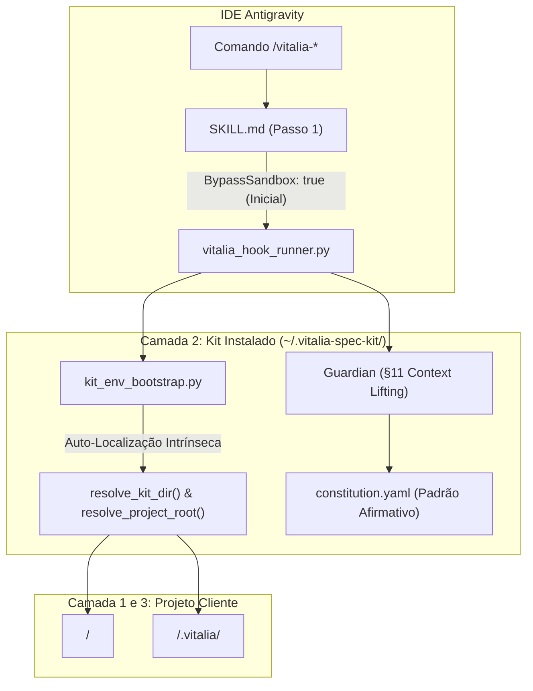

<!-- ADR-0005-proactive-sandbox-elevation-and-agnostic-governance.md | Vitalia SPEC Kit v0.0.1 | 11-11-2026 21:30(GMT-04:00) -->
> **ADR-0005-proactive-sandbox-elevation-and-agnostic-governance.md | Vitalia SPEC Kit v0.0.1 | 11-11-2026 21:30(GMT-04:00)**

# ADR-0005: Elevação Proativa de Sandbox, Governança Agnóstica e Minimalista de Agentes, Purga de Variáveis Redundantes, Padrão Afirmativo e Saneamento Dinâmico

- **Status:** Proposto (Pausa HITL Soberana)
- **Data:** 11-11-2026
- **Autor:** Vitalia Architect (`/vitalia-architect`)
- **Feature:** `specs/006-sandbox-elevation-and-dynamic-constitution`
- **Fontes Canônicas:**
  - [`specs/006-sandbox-elevation-and-dynamic-constitution/research-brainstorming.md`](file:///home/andre/projetos/assistidos/vitalia-spec-kit/specs/006-sandbox-elevation-and-dynamic-constitution/research-brainstorming.md)
  - [`docs/adr/ADR-0001-universal-bootstrap-4-layer-topology-no-prune.md`](file:///home/andre/projetos/assistidos/vitalia-spec-kit/docs/adr/ADR-0001-universal-bootstrap-4-layer-topology-no-prune.md)
  - [`docs/adr/ADR-0004-dual-runtime-architecture-and-runner-inviolability.md`](file:///home/andre/projetos/assistidos/vitalia-spec-kit/docs/adr/ADR-0004-dual-runtime-architecture-and-runner-inviolability.md)

---

## 1. Contexto e Motivação

Durante a operação prática do Kit e o início de novas sessões de trabalho, foram identificados atritos e desalinhamentos que afetam tanto a experiência do usuário quanto o raciocínio das IAs orquestradoras:

1. **Colisão Inicial de Sandbox da IDE (Código de Saída 127):** O sandbox padrão da IDE Antigravity restringe o isolamento de montagem ao diretório do workspace (`project_root`). Comandos disparados inicialmente pelo agente em `BypassSandbox: false` falham com `Exit code 127 (No such file or directory)` ao tentar referenciar o interpretador do kit em `~/.vitalia-spec-kit/.venv/bin/python3`. A regra do sistema estabelece que o sandbox pode ser contornado *"unless mentioned otherwise"*.
2. **Contaminação Conceitual de Topologia e Acoplamento no `AGENTS.md`:** O `AGENTS.md` apresentava uma "Topologia de 4 Camadas", citando a pasta `source/` que só existe no repositório de desenvolvimento e não existe no kit instalado no cliente. Além disso, regras específicas de software (como TDD e Falsificação) poluíam a governança geral de agentes, que deve atender a múltiplos especialistas (médicos, acadêmicos, design).
3. **Âncoras Semânticas Negativas (Efeito Elefante Rosa):** Citar ferramentas inexistentes (como `sdd_judge.py`) ou proibir ações específicas (`kit-bootstrap.sh`) atua como gatilho cognitivo, induzindo modelos de linguagem a tentar executar os itens citados durante cenários de falha.
4. **Redundância e Acoplamento da Variável `VITALIA_KIT_DIR` no `.env`:** O instalador injetava caminhos absolutos locais do usuário no `.env` do projeto cliente, criando dependências desnecessárias quando o próprio módulo `kit_env_bootstrap.resolve_kit_dir()` já resolve a localização física intrínseca do kit.
5. **Números Mágicos Estáticos (Violação do FR-006):** Presença de faixas fixas (`P00–P17`, `16 workflows`, `14 lentes`, `6 catálogos`) em 26 pontos de código e prompts, engessando a extensibilidade do sistema.
6. **Violações ao Padrão Afirmativo ("Say what to do instead of what not to do"):** Proibições negativas na constituição e perfis criam ambiguidade comportamental e aumentam a taxa de alucinação dos modelos.

---

## 2. Decisões Arquiteturais Estruturantes

### 2.1. Elevação Proativa de Sandbox (`BypassSandbox: true` Inicial)
- **Decisão:** Padronizar o Passo 1 do arquivo `source/integrations/antigravity/SKILL.md.template` e de todas as skills em `.agents/skills/*/SKILL.md` para prescrever a execução com elevação:
  ```markdown
  1. Execute o comando com elevação de sandbox mandatória e inicial (`BypassSandbox: true`):
     ```bash
     {{KIT_PYTHON}} {{VITALIA_KIT_DIR}}/src/vitalia_hook_runner.py ...
     ```
  ```
- **Consequência:** Aciona a exceção explícita *"unless mentioned otherwise"* das diretrizes de sandbox da IDE Antigravity, eliminando de forma definitiva a ocorrência do erro 127 no primeiro turno de qualquer comando.

### 2.2. Topologia Real de 3 Camadas no Kit Instalado
- **Decisão:** Declarar explicitamente que a pasta `source/` pertence unicamente ao repositório raiz de desenvolvimento do kit. No ambiente do usuário instalado, existem estritamente **3 Camadas Reais**:
  - **Camada 1 (Projeto do Usuário):** `<project_root>/` — Código e arquivos de trabalho do projeto assistido.
  - **Camada 2 (Kit Vitalia Instalado):** `<kit_dir>/` (padrão `~/.vitalia-spec-kit/`) — Scripts de governança, extensões, perfis e interpretador Python isolado (`.venv`).
  - **Camada 3 (Memória Persistente do Projeto):** `<project_root>/.vitalia/` — Contexto persistente segregado em `session/` e dados operacionais em `data_storage/`.
- **Resolução de Caminhos:** Resolução determinística e exclusiva via utilitários do kit: `kit_env_bootstrap.resolve_project_root()` e `kit_env_bootstrap.resolve_kit_dir()`.

### 2.3. AGENTS.md Minimalista Agnóstico (~35 linhas)
- **Decisão:** Reduzir o `AGENTS.md` a um manifesto conciso, neutro e aplicável a qualquer domínio:
  - Delegação de regras de desenvolvimento de software (TDD, P05) para a Constituição dinâmica (`constitution.yaml`).
  - Remoção completa de referências a scripts inexistentes (`sdd_judge.py`) e proibições de `kit-bootstrap.sh`.
  - Apresentação do ecossistema de especialistas com roteamento dinâmico sem lista fixa de domínios.
  - Primazia da auto-descoberta e do Context Lifting sem poda (§11).

### 2.4. Purga da Variável `VITALIA_KIT_DIR` do `.env` do Cliente
- **Decisão:** Remover a injeção de `VITALIA_KIT_DIR` em `source/bin/lib/env_manager.sh`. O Kit se auto-localiza de maneira infalível a partir de sua localização em disco via `kit_env_bootstrap.resolve_kit_dir()` (`Path(__file__).resolve().parent.parent`).
- **Consequência:** Elimina caminhos absolutos desnecessários no `.env` do projeto hospedeiro, tornando o `.env` do cliente mais limpo e imune a quebras por movimentação de diretórios.

### 2.5. Saneamento Dinâmico de Números Mágicos (FR-006)
- **Decisão:** Substituir contadores fixos e faixas estáticas nos 26 pontos mapeados do sistema:
  - De: `P00–P17`, `16 workflows`, `14 lentes`, `6 catálogos`.
  - Para: Consultas dinâmicas a `len(principles)`, `len(extensions)`, `len(profiles)` ou redação semântica (*"integralidade dos princípios constitucionais ativos"*).

### 2.6. Adoção Integral do Padrão Afirmativo
- **Decisão:** Reformular todas as diretrizes negativas em `constitution.yaml`, `gp_*.yaml` e `extensions/*.toml` adotando o padrão afirmativo canônico (*"Describe the shape you want, not the hole"*).
- **Grounding e Verificação (P03):**
  - Redação afirmativa unificada: *"Toda citação de versão, documentação, endpoint ou alegação científica exige confirmação de link ativo (HTTP 200) seguida de leitura integral da fonte."*
  - Barreira de orquestração síncrona: o agente orquestrador deve aguardar o retorno conclusivo do sub-agente com links auditados e registrar o rastro no artefato final.

---

## 3. Conformidade Constitucional

- **P00 (Human Wellbeing First):** Elimina frustração do usuário com erros de cold-start 127 e loops de auto-reinstalação.
- **P01 (SDD Pipeline Inviolability):** Condução formal do ciclo SDD a partir da regência arquitetural.
- **P03 (External Verification Protocol / Grounding):** Rastreabilidade empírica estrita com confirmação HTTP 200 antes de emissão de conclusões.
- **P04 (Timestamp & GMT-04:00):** Cabeçalho e fuso Cuiabá em todos os artefatos.
- **P05 (Test-First Development & Behavioral Falsification):** Enquadramento da suíte de testes nas 4 modalidades ([TEST:NEW], [TEST:BUGFIX], [TEST:REFACTOR], [TEST:MIGRATION]).
- **P11 (Hardware & Environment Agnosticism):** Auto-localização pura sem caminhos absolutos desnecessários no `.env`.
- **P16 (Artifact Integrity & Mermaid):** Diagramas com labels entre aspas duplas e ordem cronológica reversa.

---

## 4. Diagrama de Transição Arquitetural



---

## 5. Próximos Passos (Ciclo SDD)

1. Validação HITL deste ADR.
2. Elaboração do Plano de Turno em `specs/006-sandbox-elevation-and-dynamic-constitution/regencia-architect-plano-turno.md`.
3. Transição formal com handoff para `/vitalia-spec-specify`.

