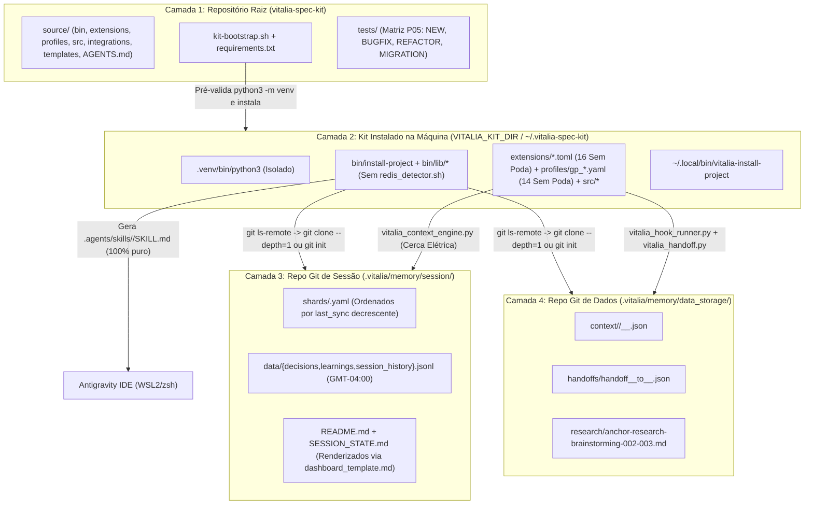

<!-- regencia-architect-plano-turno.md | Vitalia SPEC Kit v0.0.1 | 08-11-2026 18:43(GMT-04:00) -->
> **regencia-architect-plano-turno.md | Vitalia SPEC Kit v0.0.1 | 08-11-2026 18:43(GMT-04:00)**

# 🏛️ Plano de Regência Técnica — Vitalia Architect (`specs/002-universal-bootstrap-runtime`)

- **Condutor:** Vitalia Architect (`/vitalia-architect`)
- **Insumos Canônicos Obrigatórios:**
  1. [`specs/002-universal-bootstrap-runtime/research-brainstorming.md`](file:///home/andre/projetos/assistidos/vitalia-spec-kit/specs/002-universal-bootstrap-runtime/research-brainstorming.md)
  2. [`.vitalia/memory/data_storage/research/anchor-research-brainstorming-002-003.md`](file:///home/andre/projetos/assistidos/vitalia-spec-kit/.vitalia/memory/data_storage/research/anchor-research-brainstorming-002-003.md)
  3. [`docs/adr/ADR-0001-universal-bootstrap-4-layer-topology-no-prune.md`](file:///home/andre/projetos/assistidos/vitalia-spec-kit/docs/adr/ADR-0001-universal-bootstrap-4-layer-topology-no-prune.md)

---

## 1. Fluxo Arquitetural e Isolamento das 4 Camadas (Mermaid Nativo — P16)

---

## 2. Auditoria Holística de Conformidade Constitucional (P00–P17 Sem Poda)

| Princípio | Status | Diretriz de Conformidade Imposta pelo Architect |
|---|---|---|
| **P00** (Purpose Arbiter) | ✅ CONFORME | Elimina fricção cognitiva e falhas silenciosas de instalação em ambientes reais (`WSL2/zsh`). |
| **P01** (SDD Pipeline Inviolability) | ✅ CONFORME | Pipeline completo exigido: `brainstorming → route → architect → specify → clarify → plan → tasks → task-verifier → analyze → implement → converge → judge → session-end`. |
| **P02** (User-Centric Validation) | ✅ CONFORME | Impacto direto ao desenvolvedor/pesquisador: instalação previsível, sem exigência de Docker/Redis e sem perda de slash commands na IDE. |
| **P03** (External Verification / Grounding) | ✅ CONFORME | 10 domínios em `grounding_domains.yaml` com validade temporal (`valid_until`), extensão `/vitalia-research` (`research.toml`) e validação HTTP 200. |
| **P04** (Timestamp & GMT-04:00 Integrity) | ✅ CONFORME | Cabeçalhos P04 em todos os arquivos e formato `DD-MM-YYYY HH:MM:SS(GMT-04:00)` obrigatório em `core/utils.py`, `shard_manager.py` e `.jsonl`. |
| **P05** (Behavioral Falsification Matrix) | ✅ CONFORME | Aplicação estrita de `[TEST:NEW]`, `[TEST:BUGFIX]`, `[TEST:REFACTOR]`, `[TEST:MIGRATION]` com Cenário de Falsificação e bloqueio (`BLOCK`) de asserções sintáticas `is_file()`. |
| **P06** (Secrets Never in Git) | ✅ CONFORME | `.gitignore` blinda `.env`, `.vitalia/*` e credenciais; `env_manager.sh` opera apenas localmente. |
| **P07** (Privacy & Zero Data Leak) | ✅ CONFORME | Envelopes de Context Lifting saem de `~/.vitalia/tmp/` e passam a ser gravados isoladamente em `<project_root>/.vitalia/memory/data_storage/context/<machine_id>/`. |
| **P08** (Smart Routing & Min Privilege) | ✅ CONFORME | Tríade `brainstorming_intents.yaml` (7 domínios) $\rightarrow$ `agents_catalog.yaml` $\rightarrow$ `routing_table.yaml` e ferramentas mínimas por `.toml`. |
| **P09** (Medical Safety Gate) | ✅ CONFORME | Preservado em `constitution.yaml`, `grounding_domains.yaml` (`clinical_safety`) e `brainstorming_intents.yaml` (`saude_clinica` com `p0_flag: true`). |
| **P10** (Didactics-First & `--help`) | ✅ CONFORME | Todos os scripts CLI Python (`vitalia_hook_runner.py`, `vitalia_context_engine.py`, `vitalia_handoff.py`, `kit_env_bootstrap.py`, `scan_environment.py`, `guardian_context.py`) implementam `--help` didático. |
| **P11** (Hardware-Agnostic & OpenAPI 3.0) | ✅ CONFORME | Schemas JSON seguem OpenAPI 3.0 limpo; `machine_id` derivado via SHA256[:8]; `VITALIA_KIT_DIR` parametrizável sem caminhos fixos `~/.vitalia`. |
| **P12** (Agent Security) | ✅ CONFORME | Validação estrutural de schemas em handoffs e confirmação HITL soberana em todas as transições críticas. |
| **P13** (API Safety Gate) | ✅ CONFORME | Preservado integralmente em `constitution.yaml` e `grounding_domains.yaml` (`security_practices`). |
| **P14** (Evidence Traceability) | ✅ CONFORME | Rastreabilidade completa de decisões (`decisions.jsonl`), aprendizados (`learnings.jsonl`) e histórico (`session_history.jsonl`). |
| **P15** (Observability) | ✅ CONFORME | Logs de instalação (`logger.sh`) e diagnóstico estruturado em `scan_environment.py` no filesystem local. |
| **P16** (Artifact Integrity & Mermaid) | ✅ CONFORME | Labels Mermaid entre aspas duplas sem CSS intrusivo; inserção cronológica reversa (mais recente no topo) em `shard_manager.py` e históricos. |
| **P17** (EU AI Act Compliance) | ✅ CONFORME | Preservado em `constitution.yaml` e `grounding_domains.yaml` (`regulations_compliance`) com supervisão HITL. |

---

## 3. Enquadramento de Engenharia Reversa (3 Camadas) e Matriz de Testes (P05)

1. **Preservação Funcional (`[TEST:MIGRATION]`):**
   - Portar de `~/.vitalia` para `source/src/` a arquitetura completa do motor de contexto (`vitalia_context_engine.py`, `core/context_engine.py`, `core/shard_manager.py`, `core/utils.py`, `rendering/dashboard_renderer.py`, `rendering/view_renderer.py`, `rendering/grounding_renderer.py`, `rendering/constitution_renderer.py`) e os hooks (`vitalia_hook_runner.py`, `hooks/guardian_context.py`, `hooks/scan_environment.py`, `kit_env_bootstrap.py`), purgando Redis/telemetria/`tmp/` global.
   - Preservar em `source/bin/lib/git_storage_manager.sh` a verificação `git ls-remote` e clonagem `git clone --depth=1` para repositórios remotos existentes e fallback `git init` para projetos novos/vazios.
2. **Correções de Defeitos Reproduzidos (`[TEST:BUGFIX]`):**
   - Pré-validação de `python3 -m venv` em `kit-bootstrap.sh` (RCA-02).
   - Pureza estrita de `.agents/skills/` em `agent_preserver.sh` e `install-project` (RCA-04).
   - Ordenação decrescente de shards por `last_sync` (`parse_sync_time`) em `shard_manager.py` para que `shards[0]` em `SESSION_STATE.md` e `README.md` seja sempre a máquina mais recente (RCA-05).
   - Remoção total de qualquer algoritmo de poda em `guardian_context.py`, remoção da poda `total_budget: 350` em `gp_session-start.yaml` e criação de `gp_session-end.yaml` e `gp_session-consolidate.yaml` (`no_prune: true`, `total_budget: 0`), garantindo que 100% dos 16 workflows trabalhem sem poda.
3. **Capacidades e Contratos Novos (`[TEST:NEW]`):**
   - `kit-bootstrap.sh` parametrizável (`--target-dir` / `VITALIA_KIT_DIR`, padrão `~/.vitalia-spec-kit`), 16 extensões `.toml` canônicas 100% sem poda, 14 lentes `gp_*.yaml` sem poda, catálogos `grounding_domains.yaml` (10 domínios), `dynamic_questioning.yaml` (9 domínios), `brainstorming_intents.yaml` (7 domínios) e `source/AGENTS.md`.

