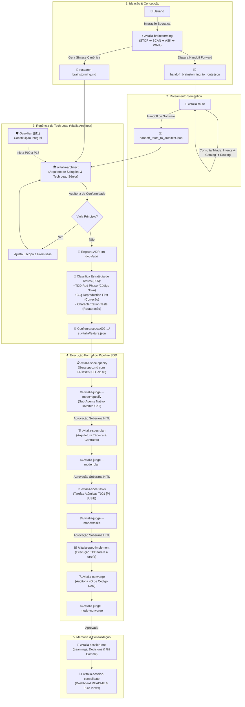

<!-- regencia-architect-plano-turno.md | Vitalia SPEC Kit v0.0.1 | 04-11-2026 18:05(GMT-04:00) -->
> **regencia-architect-plano-turno.md | Vitalia SPEC Kit v0.0.1 | 04-11-2026 18:05(GMT-04:00)**

# Regência do Vitalia Architect & Plano Detalhado do Turno

---

## 1. O Papel de Regência do Vitalia Architect

No **Vitalia SPEC Kit (v0.0.1)**, o **Vitalia Architect** (`/vitalia-architect`) atua como o **Arquiteto de Soluções e Tech Lead Sênior**. Ele é o maestro do ciclo de vida técnico do projeto, preenchendo o abismo histórico que existia entre a ideação livre e a codificação direta.

### Pilares Fundamentais da Regência:

1. **Recepção do Bastão e Desacoplamento:**
   - O Architect não substitui o Brainstorming (espaço socrático de ideação) nem o Route (despachante determinístico).
   - Ele recebe o handoff formal do `/vitalia-route` contendo o [research-brainstorming.md](file:///home/andre/projetos/assistidos/vitalia-spec-kit/specs/002-universal-bootstrap-runtime/research-brainstorming.md).
2. **Inviolabilidade Constitucional Holística:**
   - O Architect é o primeiro agente a confrontar os consensos do Brainstorming com a **Constituição integral** injetada pelo Guardian (§11).
   - Valida conformidade com princípios inegociáveis: P00 (Human Wellbeing), P01 (SDD Pipeline Inviolability), P03 (Grounding e Verificação de 2026), P04 (GMT-04:00 e Marca Canônica), P05 (Estratégia de Testes Contextual) e P11 (Contratos OpenAPI 3.0 puros e Runtime Agnóstico).
3. **Formalização de Decisões Arquiteturais (ADRs):**
   - Nenhuma decisão estruturante (escolha de bibliotecas, persistência em filesystem puro, particionamento de shards por `machine_id`, isolamento via venv dedicado) é deixada implícita. O Architect gera ou atualiza o ADR correspondente em `docs/adr/`.
4. **Enquadramento da Estratégia de Testes (P05):**
   - Classifica formalmente a natureza do trabalho:
     - **Código Novo:** TDD Estrito (Red ➔ Green ➔ Refactor).
     - **Bugfix / Correção de Defeito:** Bug Reproduction Test First (teste que reproduz a falha antes da correção).
     - **Refatoração / Purga:** Characterization / Golden Master Tests (garantia da suite verde antes e depois de expurgar o legado).
5. **Condução Mandatória do Pipeline SDD:**
   - O Architect estabelece o diretório da feature ativa em `specs/<NNN>-<slug>/`, aponta `.vitalia/feature.json` e despacha para `/vitalia-spec-specify`.
   - Ele acompanha a evolução pelas fases (`specify` ➔ `plan` ➔ `tasks` ➔ `implement` ➔ `converge`), servindo de árbitro técnico caso surjam desvios de especificação.

---

## 2. Diagrama Completo de Regência (Mermaid em Tema Nativo)

> [!NOTE]
> Em conformidade com o **Pivô 8** da Spec 002, o diagrama abaixo adota Mermaid puro (sem classes CSS manuais ou cores hardcoded) para garantir contraste perfeito e renderização harmoniosa no tema escuro/claro nativo da IDE Antigravity.

---

## 3. Relatório Detalhado de Progresso do Turno (Daqui até o Final)

A execução deste turno para a entrega do **MVP da Spec 002: Universal Bootstrap & Runtime** no repositório [vitalia-spec-kit](file:///home/andre/projetos/assistidos/vitalia-spec-kit) seguirá rigorosamente a sequência de fases abaixo:

### Fase 1: Roteamento e Ativação do Architect (Imediato)
* **Ação:** Executar `/vitalia-route` para consumir o [handoff_brainstorming_to_route_dfc9bb41.json](file:///home/andre/projetos/assistidos/vitalia-spec-kit/.vitalia/memory/data_storage/handoffs/handoff_brainstorming_to_route_dfc9bb41.json).
* **Resultado:** Confirmação do domínio `arquitetura_software` e transferência determinística para o **/vitalia-architect**.
* **Postura:** O Architect assume o comando técnico, valida o [research-brainstorming.md](file:///home/andre/projetos/assistidos/vitalia-spec-kit/specs/002-universal-bootstrap-runtime/research-brainstorming.md) contra a Constituição e oficializa o início do pipeline SDD.

### Fase 2: Especificação Formal (`spec.md`) e Auditoria Inicial
* **Ação:** Execução do `/vitalia-spec-specify`.
* **Entregável:** Geração do `specs/002-universal-bootstrap-runtime/spec.md`:
  - Requisitos Funcionais agnósticos (`FR-001` a `FR-012`) estruturados segundo a ISO 29148.
  - Cenários de Aceite (Given / When / Then) para bootstrap, isolamento de venv, purga de Redis/Docker e Context Lifting seguro.
  - Links externos verificados de 2026 com comprovação de HTTP 200 (P03).
* **Gate de Inspeção:** Disparo compulsório do Sub-Agente nativo `/vitalia-judge --mode=specify`.
* **HITL Soberano:** Pausa para revisão humana e aprovação do `Relatório de Inspeção - specify.md`.

### Fase 3: Planejamento Arquitetural (`plan.md`) & ADRs
* **Ação:** Execução do `/vitalia-spec-plan`.
* **Entregável:** Geração do `specs/002-universal-bootstrap-runtime/plan.md`:
  - Desenho do instalador universal `kit-bootstrap.sh` e shims em `~/.local/bin/`.
  - Especificação da purga radical dos sockets legados de Redis e Postgres em `scan_environment.py`.
  - Definição do novo layout de Context Lifting em `.vitalia/memory/data_storage/context/`.
  - Contratos OpenAPI 3.0 limpos (sem `$schema` e sem `additionalProperties: false`).
* **Gate de Inspeção:** Submissão adversarial ao `/vitalia-judge --mode=plan` e aprovação humana.

### Fase 4: Decomposição Atômica de Tarefas (`tasks.md`)
* **Ação:** Execução do `/vitalia-spec-tasks`.
* **Entregável:** Geração do `specs/002-universal-bootstrap-runtime/tasks.md`:
  - Lista de tarefas atômicas sequenciais (`T001 [P] [US1]` a `T025`).
  - Mapeamento explícito de arquivos exatos em `source/bin/`, `source/src/`, `source/extensions/` e `source/profiles/`.
  - Classificação de testes (P05): Characterization tests para os utilitários refatorados; TDD para novas funções de runtime.
* **Gate de Inspeção:** Auditoria adversarial via `/vitalia-judge --mode=tasks` e aprovação humana.

### Fase 5: Implementação Rigorosa (TDD & Purga do Legado)
* **Ação:** Execução do `/vitalia-spec-implement` tarefa a tarefa.
* **Critérios de Execução:**
  - **Zero Transplante Cego:** Refatoração manual e intencional de cada script em [source/src/](file:///home/andre/projetos/assistidos/vitalia-spec-kit/source/src/).
  - **Purga de Código Morto:** Remoção de `redis-py`, fallbacks de container e referências a `sdd_judge.py`.
  - **Aplicação da Nova Marca:** Todo cabeçalho criado ou editado conterá a assinatura `Vitalia SPEC Kit v0.0.1` e fuso imutável `America/Cuiaba (GMT-04:00)`.
  - **Atualização dos 12 TOMLs:** Refatoração de todos os arquivos de extensão em [source/extensions/](file:///home/andre/projetos/assistidos/vitalia-spec-kit/source/extensions/) alinhados aos contratos da Seção 4 do briefing.

### Fase 6: Convergência, Julgamento Final & Consolidação
* **Ação:** Execução do `/vitalia-converge` e `/vitalia-judge --mode=converge`.
* **Resultado:** Auditoria 4D comprovando que não existem stubs vazios (`pass`), que os testes executam com 100% de sucesso e que o código real bate integralmente com a `spec.md`.
* **Fechamento do Ciclo:** 
  - `/vitalia-session-end` para registrar os aprendizados da refatoração e commit git atômico.
  - `/vitalia-session-consolidate` para atualizar o Dashboard com o status do novo produto.

---

*Documento formalizado e registrado na spec ativa sob a autoridade técnica da governança Vitalia SPEC Kit.*
