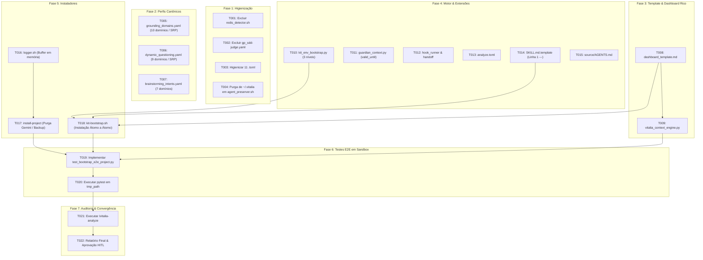

<!-- tasks.md | Vitalia SPEC Kit v0.0.1 | 06-11-2026 22:35:00(GMT-04:00) -->
> **tasks.md | Vitalia SPEC Kit v0.0.1 | 06-11-2026 22:35:00(GMT-04:00)**

# Lista de Tarefas Atômicas — Spec 003: Fix Universal Bootstrap Omissions (v0.0.1)

---

## 1. Visão Geral do Escopo e MVP

O objetivo da **Spec 003** é sanar integralmente as omissões e regressões identificadas após a Spec 002 através de uma esteira de instalação átomo a átomo, restauração do painel de memória rico, governança temporal com padrão SRP em perfis e auditoria nativa na IDE.

- **Total de Tarefas:** 22 tarefas atômicas
- **Critério de Conclusão:** 100% das tarefas marcadas como `[X]` e validadas pelo teste E2E em sandbox.
- **Restrição Mandatória:** Todo teste automatizado roda estritamente em `tmp_path` sem modificar a máquina host.

---

## 2. Fases de Execução

### Fase 1: Higienização & Purga de Legado (Fundação)
- [X] **T001** [P] [US1] Excluir fisicamente o script legado `source/bin/lib/redis_detector.sh`.
- [X] **T002** [P] [US1] Excluir fisicamente o perfil obsoleto de VRAM fatiada `source/profiles/gp_sdd-judge.yaml`.
- [X] **T003** [US1] Higienizar os 11 arquivos `.toml` em `source/extensions/`, removendo a linha obsoleta `guardian_profile = "gp_*"` e purgando princípios constitucionais hardcoded para carregamento estritamente dinâmico via `guardian_json.sources.constitution.principles`.
- [X] **T004** [US2] Atualizar `source/bin/lib/agent_preserver.sh` para resolver o kit via `${VITALIA_KIT_DIR:-${HOME}/.vitalia-spec-kit}`, eliminando qualquer menção ao caminho legado `~/.vitalia`.

---

### Fase 2: Perfis Canônicos com Governança Temporal & Padrão SRP
- [X] **T005** [US3] Criar `source/profiles/grounding_domains.yaml` contendo os 10 domínios canônicos com datas válidas (`valid_until`), fontes autoritativas auditáveis, governança temporal e padrão SRP no domínio `software_architecture`.
- [X] **T006** [US3] Criar `source/profiles/dynamic_questioning.yaml` contendo os 9 domínios canônicos com trade-offs estruturais desacoplados de Redis/Celery/Ollama e orientados a componentes com responsabilidade única (SRP).
- [X] **T007** [US3] Atualizar `source/profiles/brainstorming_intents.yaml` expandindo para os 7 domínios semânticos do ecossistema.

---

### Fase 3: Template Canônico & Restauração do Dashboard de Memória
- [X] **T008** [US4] Criar `source/templates/dashboard_template.md` contendo o layout canônico rico (badges de estado, topologia Mermaid `flowchart TD`, tabela executiva de máquinas, sessão ativa em destaque e seções colapsáveis `
`), higienizado de dependências de Redis.
- [X] **T009** [US4] Atualizar `source/src/vitalia_context_engine.py` incorporando o motor de renderização visual no `LocalContextEngine.action_consolidate()`, resolvendo o template via `kit_env_bootstrap.resolve_kit_dir()` e preenchendo os dados de `session_history.jsonl`, `decisions.jsonl` e `grounding_domains.yaml`.

---

### Fase 4: Resolução de Ambiente, Hooks, Skills e Workflow Analyze
- [X] **T010** [US1] Atualizar `source/src/kit_env_bootstrap.py` implementando a resolução em 3 níveis (`os.environ` $\rightarrow$ `.env` $\rightarrow$ fallback `$HOME/.vitalia-spec-kit`) e purgando totalmente referências a `~/.vitalia`.
- [X] **T011** [US3] Atualizar `source/src/hooks/guardian_context.py` removendo busca de perfis `gp_*` e adicionando verificação de expiração temporal (`valid_until`) dos domínios carregados (`ACTIVE`/`STALE`).
- [X] **T012** [US1] Atualizar `source/src/vitalia_hook_runner.py` e `source/src/vitalia_handoff.py` garantindo precedência de `.venv/bin` no PATH e Zero Data Leak com caminho parametrizado.
- [X] **T013** [US5] Criar `source/extensions/analyze.toml` como workflow nativo da Antigravity IDE com suporte aos modos `after_tasks` e `after_implement` (classificação Git Diff em 3 camadas e verificação estática de call sites com pausa HITL soberana).
- [X] **T014** [US2] Atualizar `source/integrations/antigravity/SKILL.md.template` garantindo que o frontmatter YAML inicie na Linha 1 estritamente com `---` e aponte para `{{VITALIA_KIT_DIR}}/.venv/bin/python3`.
- [X] **T015** [US1] Atualizar `source/AGENTS.md` com as diretrizes canônicas deste repositório (anti-Lost in the Middle, numeração de specs 3 dígitos e HITL soberano).

---

### Fase 5: Instaladores e Bibliotecas de Shell
- [X] **T016** [US2] Atualizar `source/bin/lib/logger.sh` implementando o acumulador em memória `_VITALIA_LOG_BUFFER` e a função `write_install_log`.
- [X] **T017** [US2] Atualizar `source/bin/install-project` eliminando menus e referências ao Gemini CLI, acionando o backup condicional de `.agents` apenas com `DATA_REPO`, gerando log detalhado condicional e gravando `analyze` em `extensions.yml`.
- [X] **T018** [US1] Atualizar `kit-bootstrap.sh` implementando prompt interativo com default `~/.vitalia-spec-kit`, expansão do til (`~`), esteira de instalação átomo a átomo (copiando explicitamente `templates/`, `integrations/`, `AGENTS.md`) e geração do shim parametrizado `~/.local/bin/vitalia-install-project`.

---

### Fase 6: Verificação & Teste E2E em Sandbox
- [X] **T019** [US1] [US2] [US4] Implementar o teste automatizado de fumaça E2E em `tests/test_bootstrap_e2e_project.py` simulando execução ponta a ponta de `kit-bootstrap.sh`, `install-project` e `vitalia_context_engine.py --action consolidate` estritamente dentro de `tmp_path`.
- [X] **T020** [US1] Executar `pytest tests/test_bootstrap_e2e_project.py` e certificar 100% de testes passando com isolamento total do sistema host.

---

### Fase 7: Auditoria de Consistência e Convergência
- [X] **T021** [US5] Executar a auditoria de consistência do workflow `/vitalia-analyze` no modo `after_implement` verificando os deltas em código real.
- [X] **T022** Realizar a inspeção constitucional final com emissão do relatório e submissão à aprovação humana soberana (HITL Soberano).

---

## 3. Matriz de Dependência Entre Tarefas

