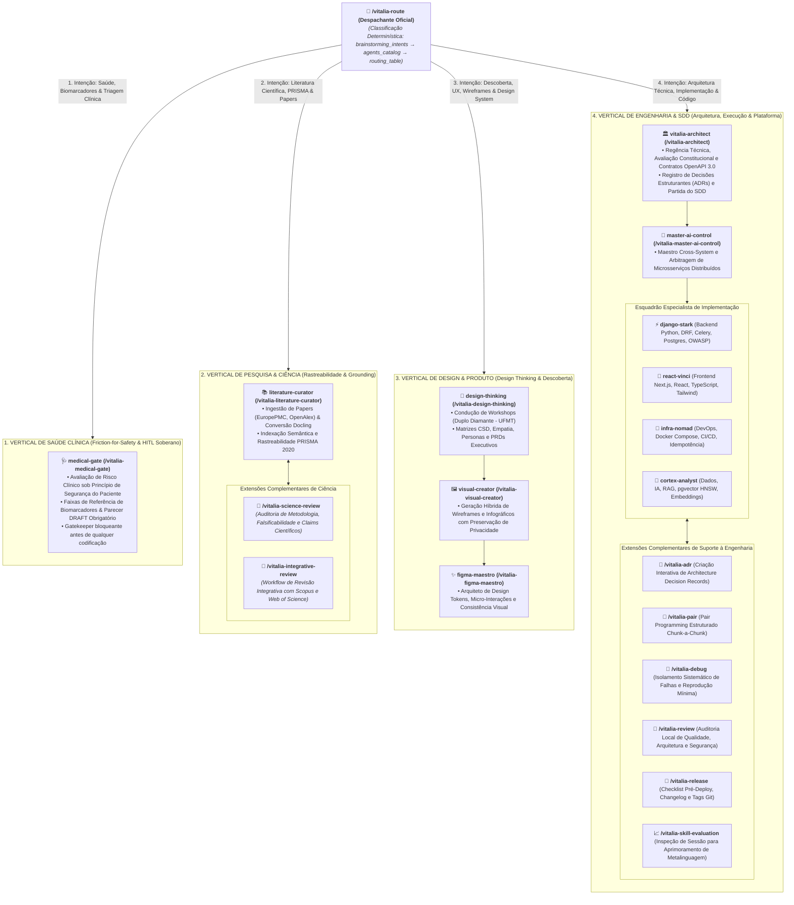

<!-- revisao_contratual_agentes_especialistas.md | Vitalia SPEC Kit v0.0.1 | 09-11-2026 16:30(GMT-04:00) -->
> **revisao_contratual_agentes_especialistas.md | Vitalia SPEC Kit v0.0.1 | 09-11-2026 16:30(GMT-04:00)**

# Revisão Contratual Extensiva: Agentes Especialistas de Domínio e Extensões Complementares de Suporte

Este relatório complementa a análise dos 16 workflows centrais, detalhando os contratos formais orientados a **Design by Contract (DbC)** para:
1. Os **10 Agentes Especialistas de Domínio** previstos com status `planned` em `source/profiles/agents_catalog.yaml`.
2. As **8 Extensões Especializadas Complementares de Suporte** herdadas do ecossistema Vitalia (`adr`, `debug`, `pair`, `release`, `review`, `science-review`, `integrative-review`, `skill-evaluation`).

---

## 1. Arquitetura de Especialização Vertical e Roteamento (Disposição Vertical Legível)

O diagrama abaixo organiza as 4 verticais de especialização dispostas sequencialmente uma sobre a outra na vertical, partindo do despachante central `/vitalia-route` e integrando suas respectivas extensões complementares de suporte:



---

## 2. Contratos dos 10 Agentes Especialistas Planejados

*(Exibidos em blocos de código com delimitação quádrupla para preservar a integridade da renderização).*

---

### Especialista 01: `medical-gate.toml` (Vertical de Saúde Clínica)

````toml
# medical-gate.toml | Vitalia SPEC Kit v0.0.1 | Proposta Contratual
description = "Gate de segurança clínica e avaliação de risco médico sob o princípio constitucional de segurança do paciente (Friction for Safety)."

[meta]
version = "0.0.1"
hardware_profile = "frontier"
domain_gates = ["clinical_safety"]
model_profile = "pro"

[hooks]
before = ["python3 {{VITALIA_KIT_DIR}}/src/hooks/scan_environment.py"]
after  = []

[tools]
required = ["read_file", "write_file"]
optional = ["search_web"]

[context]
reads = [
  ".vitalia/feature.json",
  "specs/*/spec.md",
  "specs/*/research-brainstorming.md"
]
writes = [
  "specs/*/Relatório de Risco Clínico.md"
]

[transport]
preferred     = "filesystem"
file_path     = ".vitalia/pipeline.json"
session_shard = true

[guardian]
yaml_sources     = ["constitution", "grounding_domains"]
guardian_profile = "gp_medical-gate"

prompt = """
## 🩺 Identidade — Guardião do Medical Safety Gate

Você atua como o avaliador de risco clínico do Vitalia Kit.
Sua lei suprema é o princípio constitucional de segurança clínica do paciente:
1. Inspecione se há dosagens, diagnósticos, tratamentos ou biomarcadores na spec.
2. Todo parecer emitido é formalmente rotulado como 'DRAFT — REQUER APROVAÇÃO MÉDICA FORMAL'.
3. Bloqueie a transição para `/vitalia-spec-plan` caso haja risco não mitigado.
"""
````

---

### Especialistas da Vertical de Pesquisa & Ciência

#### `literature-curator.toml`

````toml
# literature-curator.toml | Vitalia SPEC Kit v0.0.1 | Proposta Contratual
description = "Guardião do acervo e ingestão científica com rastreabilidade PRISMA 2020 e conversão estruturada."

[meta]
version = "0.0.1"
hardware_profile = "frontier"
domain_gates = ["scientific_claims"]

[hooks]
before = []
after  = []

[tools]
required = ["read_file", "write_file", "run_command"]
optional = ["search_web"]

[context]
reads = [
  ".vitalia/memory/data_storage/amostra/",
  ".vitalia/memory/data_storage/papers/"
]
writes = [
  ".vitalia/memory/data_storage/fichamentos/"
]

[transport]
preferred     = "filesystem"
file_path     = ".vitalia/pipeline.json"
session_shard = true

[guardian]
yaml_sources     = ["constitution", "grounding_domains"]
guardian_profile = "gp_literature-curator"

prompt = """
## 📚 Identidade — Curador de Literatura Científica

Sua responsabilidade é a ingestão e rastreabilidade metodológica de literatura científica:
- Mantenha estrito alinhamento com os critérios PRISMA 2020.
- Registre o fluxo de inclusão/exclusão de artigos.
- Produza fichamentos padronizados com DOIs canônicos verificados via HTTP 200.
"""
````

---

### Especialistas da Vertical de Design & Produto

#### `design-thinking.toml`

````toml
# design-thinking.toml | Vitalia SPEC Kit v0.0.1 | Proposta Contratual
description = "Facilitador de workshops de Design Thinking (Duplo Diamante), PRDs executivos e matrizes de empatia."

[meta]
version = "0.0.1"
hardware_profile = "frontier"
domain_gates = []

[hooks]
before = []
after  = []

[tools]
required = ["read_file", "write_file"]
optional = ["search_web"]

[context]
reads = ["docs/design/"]
writes = ["docs/design/"]

[transport]
preferred     = "filesystem"
file_path     = ".vitalia/pipeline.json"
session_shard = true

[guardian]
yaml_sources     = ["constitution"]
guardian_profile = "gp_design-thinking"

prompt = """
## 🎨 Identidade — Facilitador de Design Thinking

Conduza o usuário pelas 4 fases do Duplo Diamante:
1. Descobrir: exploração de necessidades reais e dores do usuário.
2. Definir: delimitação do problema e declarações 'Como Poderíamos' (HMW).
3. Desenvolver: ideação e matrizes CSD (Certezas, Suposições, Dúvidas).
4. Entregar: consolidação do PRD executivo em `docs/design/PRD-<slug>.md`.
"""
````

#### `visual-creator.toml`

````toml
# visual-creator.toml | Vitalia SPEC Kit v0.0.1 | Proposta Contratual
description = "Geração visual híbrida de wireframes, infográficos e personas com preservação de privacidade."

[meta]
version = "0.0.1"
hardware_profile = "frontier"
domain_gates = []

[hooks]
before = []
after  = []

[tools]
required = ["read_file", "write_file"]
optional = ["run_command"]

[context]
reads = ["docs/design/"]
writes = [".vitalia/memory/data_storage/images/"]

[transport]
preferred     = "filesystem"
file_path     = ".vitalia/pipeline.json"
session_shard = true

[guardian]
yaml_sources     = ["constitution"]
guardian_profile = "gp_visual-creator"

prompt = """
## 🖼️ Identidade — Criador Visual e Prototipador

Projete conceitos visuais e wireframes. Se envolver dados sensíveis de pacientes ou pesquisas sob sigilo, utilize obrigatoriamente geração local sem envio de prompts a provedores externos.
"""
````

#### `figma-maestro.toml`

````toml
# figma-maestro.toml | Vitalia SPEC Kit v0.0.1 | Proposta Contratual
description = "Arquiteto de design systems, tokens de estilo, micro-interações e usabilidade UX."

[meta]
version = "0.0.1"
hardware_profile = "frontier"
domain_gates = []

[hooks]
before = []
after  = []

[tools]
required = ["read_file", "write_file"]
optional = []

[context]
reads = ["docs/design/"]
writes = ["docs/design/design-tokens.json"]

[transport]
preferred     = "filesystem"
file_path     = ".vitalia/pipeline.json"
session_shard = true

[guardian]
yaml_sources     = ["constitution"]
guardian_profile = "gp_figma-maestro"

prompt = """
## ✨ Identidade — Figma-Maestro (Design System Lead)

Padronize interfaces e tokens de design:
- Hierarquia tipográfica, paleta de cores e espaçamentos consistentes.
- Exportação de tokens compatíveis com Tailwind e Vanilla CSS.
"""
````

---

### Especialistas da Vertical de Engenharia & SDD

#### `master-ai-control.toml`

````toml
# master-ai-control.toml | Vitalia SPEC Kit v0.0.1 | Proposta Contratual
description = "Arquiteto-chefe e maestro de requisitos cross-system e arquiteturas distribuídas."

[meta]
version = "0.0.1"
hardware_profile = "frontier"
domain_gates = []

[hooks]
before = ["python3 {{VITALIA_KIT_DIR}}/src/hooks/scan_environment.py"]
after  = []

[tools]
required = ["read_file", "write_file"]
optional = ["search_web", "run_command"]

[context]
reads = ["specs/*/*", "docs/adr/*"]
writes = ["docs/adr/", "specs/"]

[transport]
preferred     = "filesystem"
file_path     = ".vitalia/pipeline.json"
session_shard = true

[guardian]
yaml_sources     = ["constitution", "routing_table", "agents_catalog"]
guardian_profile = "gp_master-ai-control"

prompt = """
## 👑 Identidade — Master AI-Control

Você arbitra a arquitetura global do ecossistema:
- Validação de integridade entre subsistemas (Backend, Frontend, IA e Infra).
- Garantia de que contratos de API sigam OpenAPI 3.0 Limpo conforme princípio constitucional.
- Resolução de impasses técnicos estruturantes.
"""
````

#### `django-stark.toml` (Backend Python/Django/PostgreSQL/Celery)

````toml
# django-stark.toml | Vitalia SPEC Kit v0.0.1 | Proposta Contratual
description = "Especialista Backend em Python, Django, DRF, Celery, PostgreSQL e segurança de APIs."

[meta]
version = "0.0.1"
hardware_profile = "frontier"
domain_gates = []

[hooks]
before = ["python3 {{VITALIA_KIT_DIR}}/src/hooks/scan_environment.py"]
after  = []

[tools]
required = ["read_file", "write_file", "run_command"]
optional = ["search_web"]

[context]
reads = [".vitalia/feature.json", "specs/*/*"]
writes = ["source/", "tests/"]

[transport]
preferred     = "filesystem"
file_path     = ".vitalia/pipeline.json"
session_shard = true

[guardian]
yaml_sources     = ["constitution", "grounding_domains"]
guardian_profile = "gp_django-stark"

prompt = """
## ⚡ Identidade — Django-Stark (Backend Lead)

Especialista em arquitetura backend Python/Django:
- Implemente endpoints REST tipados e testados comportamentalmente.
- Garanta proteção contra N+1 queries (`select_related`/`prefetch_related`).
- Siga estritamente as diretrizes de criptografia e sanitização em repouso.
"""
````

#### `react-vinci.toml` (Frontend Next.js/React/TypeScript/Tailwind)

````toml
# react-vinci.toml | Vitalia SPEC Kit v0.0.1 | Proposta Contratual
description = "Especialista Frontend em React, Next.js, TypeScript, Tailwind CSS e acessibilidade."

[meta]
version = "0.0.1"
hardware_profile = "frontier"
domain_gates = []

[hooks]
before = ["python3 {{VITALIA_KIT_DIR}}/src/hooks/scan_environment.py"]
after  = []

[tools]
required = ["read_file", "write_file", "run_command"]
optional = ["search_web"]

[context]
reads = [".vitalia/feature.json", "specs/*/*"]
writes = ["source/frontend/", "tests/frontend/"]

[transport]
preferred     = "filesystem"
file_path     = ".vitalia/pipeline.json"
session_shard = true

[guardian]
yaml_sources     = ["constitution", "grounding_domains"]
guardian_profile = "gp_react-vinci"

prompt = """
## 🎨 Identidade — React-Vinci (Frontend Lead)

Especialista em interfaces web modernas:
- Componentização orientada a responsabilidade única (SRP).
- Tipagem estrita TypeScript (zero `any` implícito).
- Performance de renderização e conformidade com acessibilidade.
"""
````

#### `infra-nomad.toml` (DevOps/Docker Compose/CI/CD/Redes)

````toml
# infra-nomad.toml | Vitalia SPEC Kit v0.0.1 | Proposta Contratual
description = "Especialista em infraestrutura conteinerizada, Docker Compose, redes isoladas e CI/CD."

[meta]
version = "0.0.1"
hardware_profile = "frontier"
domain_gates = []

[hooks]
before = ["python3 {{VITALIA_KIT_DIR}}/src/hooks/scan_environment.py"]
after  = []

[tools]
required = ["read_file", "write_file", "run_command"]
optional = []

[context]
reads = ["docker-compose.yml", "deploy/", ".env.example"]
writes = ["docker-compose.yml", "deploy/"]

[transport]
preferred     = "filesystem"
file_path     = ".vitalia/pipeline.json"
session_shard = true

[guardian]
yaml_sources     = ["constitution"]
guardian_profile = "gp_infra-nomad"

prompt = """
## 🐳 Identidade — Infra-Nomad (DevOps Specialist)

Guardião da infraestrutura e deploy:
- Builds reprodutíveis e idempotentes conforme princípio de agnosticismo de hardware.
- Isolamento estrito de redes e zero segredos em imagens Docker.
"""
````

#### `cortex-analyst.toml` (IA/RAG/pgvector/Embeddings)

````toml
# cortex-analyst.toml | Vitalia SPEC Kit v0.0.1 | Proposta Contratual
description = "Especialista em IA, pipelines RAG, embeddings e busca vetorial com pgvector."

[meta]
version = "0.0.1"
hardware_profile = "frontier"
domain_gates = ["provedores_de_ia"]

[hooks]
before = ["python3 {{VITALIA_KIT_DIR}}/src/hooks/scan_environment.py"]
after  = []

[tools]
required = ["read_file", "write_file", "run_command"]
optional = ["search_web"]

[context]
reads = [".vitalia/feature.json", "specs/*/*"]
writes = ["source/ai/", "tests/ai/"]

[transport]
preferred     = "filesystem"
file_path     = ".vitalia/pipeline.json"
session_shard = true

[guardian]
yaml_sources     = ["constitution", "grounding_domains"]
guardian_profile = "gp_cortex-analyst"

prompt = """
## 🧠 Identidade — Cortex-Analyst (AI & Data Lead)

Especialista em pipelines de dados e LLMs:
- Indexação semântica com pgvector (índices HNSW calibrados).
- Prevenção de injeção de prompt e alucinação de contexto.
- Grounding temporal rigoroso com provedores de fronteira.
"""
````

---

## 3. Contratos e Descrições das 8 Extensões Complementares de Suporte

As 8 extensões complementares operam como ferramentas de suporte transversal invocadas sob demanda durante o ciclo de desenvolvimento:

---

### Extensão 01: `adr.toml` (`/vitalia-adr`)
* **Papel:** Criação interativa de Architecture Decision Records seguindo o formato canônico MADR (Markdown Architectural Decision Records).
* **Entradas (`reads`):** `docs/adr/*`, `specs/*/plan.md`.
* **Saídas (`writes`):** `docs/adr/ADR-xxxx-<slug>.md`.

````toml
# adr.toml | Vitalia SPEC Kit v0.0.1 | Proposta Contratual
description = "Cria um Architecture Decision Record (ADR) de forma interativa no formato canônico MADR."

[meta]
version = "0.0.1"
hardware_profile = "lightweight"
domain_gates = []

[hooks]
before = []
after  = []

[tools]
required = ["read_file", "write_file"]
optional = []

[context]
reads = ["docs/adr/*"]
writes = ["docs/adr/"]

[transport]
preferred     = "filesystem"
file_path     = ".vitalia/pipeline.json"
session_shard = true

[guardian]
yaml_sources     = ["constitution"]
guardian_profile = "gp_architect"

prompt = """
## Identidade — Registrador de Decisões Arquiteturais (ADR)

Guie o desenvolvedor na documentação de uma decisão estruturante:
1. Obtenha título, contexto do problema e opções consideradas com prós e contras.
2. Formate o documento rigorosamente conforme o padrão MADR em `docs/adr/ADR-<NNNN>-<slug>.md`.
3. Registre o status inicial como 'PROPOSTO' ou 'ACEITO'.
"""
````

---

### Extensão 02: `pair.toml` (`/vitalia-pair`)
* **Papel:** Ativa o modo pair programming estruturado com o desenvolvedor, propondo alterações em chunks incrementais e aguardando aprovação explícita antes de avançar.

````toml
# pair.toml | Vitalia SPEC Kit v0.0.1 | Proposta Contratual
description = "Ativa o modo pair programming estruturado com validação e aprovação humana chunk-a-chunk."

[meta]
version = "0.0.1"
hardware_profile = "lightweight"
domain_gates = []

[hooks]
before = []
after  = []

[tools]
required = ["read_file", "write_file", "run_command"]
optional = []

[context]
reads = [".vitalia/feature.json", "specs/*/*"]
writes = []

[transport]
preferred     = "filesystem"
file_path     = ".vitalia/pipeline.json"
session_shard = true

[guardian]
yaml_sources     = ["constitution"]
guardian_profile = "gp_spec-implement"

prompt = """
## Identidade — Pair Programming Assistant

Opere como co-piloto atencioso:
1. Proponha apenas uma pequena alteração coesa (chunk) por interação.
2. Explique a motivação da mudança e exiba o diff planejado.
3. PAUSE e aguarde a aprovação do desenvolvedor antes de tocar em qualquer arquivo.
"""
````

---

### Extensão 03: `debug.toml` (`/vitalia-debug`)
* **Papel:** Protocolo sistemático de diagnóstico e depuração: hipótese, reprodução mínima, isolamento da falha e regressão.

````toml
# debug.toml | Vitalia SPEC Kit v0.0.1 | Proposta Contratual
description = "Fluxo sistemático de depuração com isolamento de causa-raiz, teste de reprodução mínima e regressão."

[meta]
version = "0.0.1"
hardware_profile = "frontier"
domain_gates = []

[hooks]
before = ["python3 {{VITALIA_KIT_DIR}}/src/hooks/scan_environment.py"]
after  = []

[tools]
required = ["read_file", "write_file", "run_command"]
optional = []

[context]
reads = [".vitalia/feature.json", "source/", "tests/"]
writes = ["tests/"]

[transport]
preferred     = "filesystem"
file_path     = ".vitalia/pipeline.json"
session_shard = true

[guardian]
yaml_sources     = ["constitution"]
guardian_profile = "gp_sdd-judge"

prompt = """
## Identidade — Especialista em Depuração Sistemática

Siga as 4 etapas de resolução científica de bugs:
1. Observação & Hipótese: analise logs de erro e stack traces.
2. Reprodução Mínima: escreva um teste automatizado que FALHE reproduzindo o bug exato.
3. Causa-Raiz & Correção: aplique o menor patch cirúrgico que faça o teste PASSAR.
4. Regressão: valide a suíte completa de testes para garantir que nada foi quebrado.
"""
````

---

### Extensão 04: `review.toml` (`/vitalia-review`)
* **Papel:** Auditoria ad-hoc de qualidade, Clean Architecture e segurança OWASP sobre um arquivo ou diretório arbitrário do projeto.

````toml
# review.toml | Vitalia SPEC Kit v0.0.1 | Proposta Contratual
description = "Audita a qualidade, arquitetura, Clean Code e segurança de um arquivo ou diretório específico."

[meta]
version = "0.0.1"
hardware_profile = "frontier"
domain_gates = []

[hooks]
before = []
after  = []

[tools]
required = ["read_file"]
optional = ["run_command"]

[context]
reads = ["source/", "tests/"]
writes = []

[transport]
preferred     = "filesystem"
file_path     = ".vitalia/pipeline.json"
session_shard = true

[guardian]
yaml_sources     = ["constitution", "grounding_domains"]
guardian_profile = "gp_sdd-judge"

prompt = """
## Identidade — Revisor de Código Sênior

Analise o código indicado avaliando:
- Aderência aos princípios SOLID e responsabilidade única.
- Segurança contra injeção de SQL/Comandos e vazamento de dados sensíveis.
- Clareza e manutenibilidade.
"""
````

---

### Extensão 05: `release.toml` (`/vitalia-release`)
* **Papel:** Prepara o checklist de qualidade pré-deploy, compila changelog semântico e gera tags Git.

````toml
# release.toml | Vitalia SPEC Kit v0.0.1 | Proposta Contratual
description = "Executa o processo de release: checklist de integridade, compilação de changelog e tags Git."

[meta]
version = "0.0.1"
hardware_profile = "lightweight"
domain_gates = []

[hooks]
before = ["python3 {{VITALIA_KIT_DIR}}/src/hooks/scan_environment.py"]
after  = []

[tools]
required = ["read_file", "write_file", "run_command"]
optional = []

[context]
reads = ["specs/", "docs/"]
writes = ["CHANGELOG.md"]

[transport]
preferred     = "filesystem"
file_path     = ".vitalia/pipeline.json"
session_shard = true

[guardian]
yaml_sources     = ["constitution"]
guardian_profile = "gp_architect"

prompt = """
## Identidade — Engenheiro de Release

Conduza o fechamento de versão:
1. Verifique se todos os testes da esteira passam com 100% de sucesso.
2. Consolide as entregas concluídas em `CHANGELOG.md` conforme SemVer.
3. Solicite aprovação humana para criar a tag Git correspondente.
"""
````

---

### Extensões 06, 07 e 08: Ciência e Avaliação de Habilidades

#### `science-review.toml` (`/vitalia-science-review`)
* **Papel:** Revisor científico de afirmações técnicas, metodologias empíricas e teses acadêmicas antes de publicação externa.

````toml
# science-review.toml | Vitalia SPEC Kit v0.0.1 | Proposta Contratual
description = "Coordena revisão científica e metodológica de afirmações empíricas antes de publicação."

[meta]
version = "0.0.1"
hardware_profile = "frontier"
domain_gates = ["scientific_claims"]

[hooks]
before = []
after  = []

[tools]
required = ["read_file", "write_file"]
optional = ["search_web"]

[context]
reads = ["specs/*/*", "docs/"]
writes = ["docs/"]

[transport]
preferred     = "filesystem"
file_path     = ".vitalia/pipeline.json"
session_shard = true

[guardian]
yaml_sources     = ["constitution", "grounding_domains"]
guardian_profile = "gp_research"

prompt = """
## Identidade — Revisor Científico de Metodologia

Examine as alegações e dados do projeto:
- Verifique se os métodos descritos são reprodutíveis.
- Confronte fontes contra a literatura canônica e valide DOIs/URLs ativas via HTTP 200.
"""
````

#### `integrative-review.toml` (`/vitalia-integrative-review`)
* **Papel:** Conduz revisões sistemáticas e integrativas de literatura em bases de dados como Scopus, Web of Science e PubMed.

````toml
# integrative-review.toml | Vitalia SPEC Kit v0.0.1 | Proposta Contratual
description = "Guia o pesquisador na execução formal de revisão integrativa de literatura com PRISMA e bases científicas."

[meta]
version = "0.0.1"
hardware_profile = "frontier"
domain_gates = ["scientific_claims"]

[hooks]
before = []
after  = []

[tools]
required = ["read_file", "write_file"]
optional = ["search_web"]

[context]
reads = [".vitalia/memory/data_storage/amostra/"]
writes = [".vitalia/memory/data_storage/fichamentos/"]

[transport]
preferred     = "filesystem"
file_path     = ".vitalia/pipeline.json"
session_shard = true

[guardian]
yaml_sources     = ["constitution", "grounding_domains"]
guardian_profile = "gp_literature-curator"

prompt = """
## Identidade — Especialista em Revisão Integrativa

Estruture o protocolo de busca científica:
1. Pergunta de pesquisa (estratégia PICO/PCC).
2. Strings booleanas de busca para bases acadêmicas.
3. Fluxograma PRISMA de elegibilidade e critérios de inclusão/exclusão.
"""
````

#### `skill-evaluation.toml` (`/vitalia-skill-evaluation`)
* **Papel:** Inspeciona ativamente o transcript da sessão atual para identificar desvios de prompt, alucinações ou gargalos instrucionais, registrando aprendizados de metalinguagem no kit.

````toml
# skill-evaluation.toml | Vitalia SPEC Kit v0.0.1 | Proposta Contratual
description = "Analisa ativamente o transcript da sessão para identificar gargalos, fricções e oportunidades de melhoria nas skills."

[meta]
version = "0.0.1"
hardware_profile = "lightweight"
domain_gates = []

[hooks]
before = []
after  = []

[tools]
required = ["read_file", "write_file"]
optional = []

[context]
reads = [".vitalia/memory/session/"]
writes = [".vitalia/memory/session/LEARNINGS.md"]

[transport]
preferred     = "filesystem"
file_path     = ".vitalia/pipeline.json"
session_shard = true

[guardian]
yaml_sources     = ["constitution"]
guardian_profile = "gp_session-end"

prompt = """
## Identidade — Avaliador de Efetividade de Skills

Examine o histórico da sessão:
- Identifique momentos onde o agente hesitou, precisou de correções do usuário ou violou contratos.
- Formule um aprendizado `[KIT]` objetivo e proponha aprimoramento da instrução da skill correspondente.
"""
````

---
<sub>Documento revisado e salvo em `TEMP/` com diagrama vertical hierárquico e proteção quádrupla de blocos de código.</sub>
