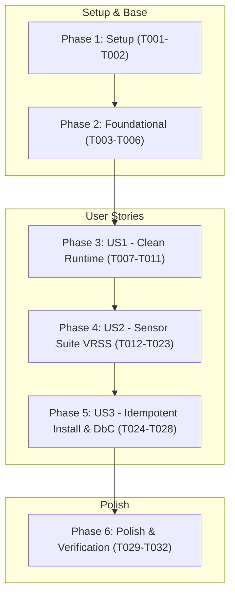

<!-- constitutional-status: APPROVED | auditor: red-team-vitalia | timestamp: 2026-11-10T14:52:14-04:00 | report: Relatório de inspeção.md -->
<!-- tasks.md | Vitalia SDD v0.6.0 | 10-11-2026 15:20(GMT-04:00) -->
> **tasks.md | Vitalia SDD v0.6.0 | 10-11-2026 15:20(GMT-04:00)**

# Tasks: 003-modular-runtime-and-sensor-suite

**Spec**: [`specs/003-modular-runtime-and-sensor-suite/spec.md`](file:///home/andre/projetos/assistidos/vitalia-spec-kit/specs/003-modular-runtime-and-sensor-suite/spec.md)  
**Plan**: [`specs/003-modular-runtime-and-sensor-suite/plan.md`](file:///home/andre/projetos/assistidos/vitalia-spec-kit/specs/003-modular-runtime-and-sensor-suite/plan.md)  
**Gerado em**: 10-11-2026 15:20 (GMT-04:00)  
**Status Constitucional**: APROVADO PELO RED TEAM (HITL SOBERANO) — PRONTO PARA IMPLEMENTAÇÃO  

---

## MVP Scope

> **Implementar Phase 1 + Phase 2 + Phase 3 (US1)** entrega o runtime modular completamente limpo, com eliminação de ruído cognitivo de atenção (`tmp_cleanup_matrix`), purga total de dependências locais do Redis e resolução defensiva resiliente de diretórios.
> As Phases 4, 5 e 6 consolidam a suíte de sensores VRSS, os contratos DbC dos 16 workflows canônicos e a automação de instalação idempotente.

---

## Phase 0: Grounding & Environment

*Verificações de ambiente e integridade pré-execução antes de qualquer modificação de código.*

- [X] T000-A Ativar ambiente virtual e checar interpretador: `python3 --version` (exigido Python 3.10+)
- [X] T000-B [P] Verificar dependências básicas instaladas no ambiente: `pytest`, `pyyaml`
- [X] T000-C [P] Verificar ausência de portas de rede abertas locais (probes de porta 6379 do Redis banidos)

---

## Phase 1: Setup

*Inicialização da infraestrutura de dados da Camada 4 e centralização de schemas. Sem label de US.*

- [X] T001 [P] Criar e assegurar a estrutura física de diretórios da Camada 4 em `.vitalia/memory/data_storage/` (`backups/skills/`, `manifests/`, `context/`, `handoffs/`)
- [X] T002 [P] Centralizar e validar os schemas JSON em `source/src/schemas/` (`context_payload.json`, `feature_metadata.json`, `session_ledger.json`, `pipeline_state.json`) em conformidade com OpenAPI 3.0 Limpo

---

## Phase 2: Foundational

*Resolução defensiva de caminhos e purga definitiva de dependências do Redis. Sem label de US.*

- [X] T003 [TEST:BUGFIX] Criar teste em `source/tests/test_kit_env_bootstrap.py` reproduzindo a falha de diretório inexistente configurado em `VITALIA_KIT_DIR` — Cenário de Falsificação: falha se `resolve_kit_dir` retornar caminho inexistente em disco ou lançar `FileNotFoundError` sem acionar fallback defensivo para `script_kit_root`
- [X] T004 Implementar validação física `candidate.exists()` e fallback gracioso para `script_kit_root` em `source/src/kit_env_bootstrap.py`
- [X] T005 [TEST:MIGRATION] Criar teste em `source/tests/test_redis_purge.py` — Cenário de Falsificação: falha se `kit_env_bootstrap.py` ou `scan_environment.py` tentarem abrir socket na porta 6379, importarem `redis` ou reportarem status `DEGRADED` por ausência de Redis local
- [X] T006 Purgar definitivamente probes de porta 6379, telemetria de Redis e imports em `source/src/kit_env_bootstrap.py` e `source/src/hooks/scan_environment.py`

---

## Phase 3: User Story 1 — Engenheiro Executa Workflows com Confiabilidade e Contexto Limpo

**Story Goal**: Garantir que as invocações de workflows entreguem payloads de contexto focados, sem sequestro de atenção pela matriz de expurgo de arquivos temporários, e com faxina isolada em CLI autônomo.  
**Independent Test**: Invocar `vitalia_hook_runner.py` e atestar ausência de `tmp_cleanup_matrix` no JSON gerado; executar `vitalia_tmp_cleanup.py --dry-run` e validar relatório didático.  
**Referência**: FR-001, FR-008, FR-011, SC-002.

- [X] T007 [P] [US1] [TEST:BUGFIX] Criar teste em `source/tests/test_hook_runner_clean.py` — Cenário de Falsificação: falha se `vitalia_hook_runner.py` injetar a chave `tmp_cleanup_matrix` ou menus interativos `[a/d/n/t]` dentro de `guardian_json`
- [X] T008 [P] [US1] Remover a injeção da `tmp_cleanup_matrix` do `guardian_json` e do fluxo de execução em `source/src/vitalia_hook_runner.py`
- [X] T009 [P] [US1] [TEST:NEW] Criar teste funcional para o CLI de faxina em `source/tests/test_vitalia_tmp_cleanup.py` — Cenário de Falsificação: falha se o utilitário não listar arquivos expirados em modo `--dry-run`, não expurgar contextos antigos quando confirmado ou falhar na flag `--help` didática
- [X] T010 [US1] Implementar utilitário autônomo CLI com interface didática em `source/src/vitalia_tmp_cleanup.py`
- [X] T011 [US1] [TEST:MIGRATION] Criar teste em `source/tests/test_context_lifting_integrity.py` — Cenário de Falsificação: falha se o contexto transitório gerado em `.vitalia/memory/data_storage/context/` violar o schema OpenAPI 3.0 ou omitir artigos da constituição integral

---

## Phase 4: User Story 2 — Arquiteto Governa o Sistema com Sensores Contínuos (VRSS)

**Story Goal**: Disponibilizar a suíte VRSS de 5 sensores executáveis para validação contínua de pureza de diretórios, contratos DbC, memória e higiene de caminhos.  
**Independent Test**: Executar individualmente os 5 scripts em `source/src/sensors/` com injeção de defeitos controlados para validar detecção precisa de anomalias.  
**Referência**: FR-002, FR-004, FR-005, FR-006, FR-010, FR-012, SC-001, SC-003, SC-004.

- [X] T012 [P] [US2] [TEST:NEW] Criar teste para o Sensor de Pureza em `source/tests/test_sensor_purity.py` — Cenário de Falsificação: falha se o sensor não reportar erro (código != 0) ao encontrar arquivos soltos, symlinks quebrados ou diretórios ocultos em `.agents/skills/`
- [X] T013 [P] [US2] Implementar `source/src/sensors/sensor_purity.py` com inspeção de `.agents/skills/` e verificação de frontmatter YAML
- [X] T014 [P] [US2] [TEST:NEW] Criar teste para o Sensor de Higiene de Caminhos em `source/tests/test_sensor_path_hygiene.py` — Cenário de Falsificação: falha se o sensor não detectar ocorrências hardcoded de `source/`, `~/.vitalia` ou caminhos absolutos locais no código do kit
- [X] T015 [P] [US2] Implementar `source/src/sensors/sensor_path_hygiene.py` com análise recursiva de código e prompts
- [X] T016 [P] [US2] [TEST:NEW] Criar teste para o Sensor de Integridade de Memória em `source/tests/test_sensor_memory_ledger.py` — Cenário de Falsificação: falha se o sensor não acusar erro ao detectar shards fora de ordem cronológica decrescente ou ledger inconsistente
- [X] T017 [P] [US2] Implementar `source/src/sensors/sensor_memory_ledger.py`
- [X] T018 [P] [US2] [TEST:NEW] Criar teste para o Sensor de Prevenção de Vazamento em `source/tests/test_sensor_tokens_leak.py` — Cenário de Falsificação: falha se o sensor não identificar credenciais expostas (P06) ou dados PHI/PII sem máscara (P07)
- [X] T019 [P] [US2] Implementar `source/src/sensors/sensor_tokens_leak.py`
- [X] T020 [P] [US2] [TEST:NEW] Criar teste para o Sensor de Contratos DbC em `source/tests/test_sensor_contract_dbc.py` — Cenário de Falsificação: falha se o sensor aprovar um arquivo de workflow sem precondições, pós-condições ou variáveis requeridas
- [X] T021 [P] [US2] Implementar `source/src/sensors/sensor_contract_dbc.py`
- [X] T022 [US2] [TEST:MIGRATION] Criar teste em `source/tests/test_agent_preserver_storage.py` — Cenário de Falsificação: falha se `agent_preserver.sh` gravar backups fora de `data_storage/backups/skills/` ou manifestos fora de `data_storage/manifests/`
- [X] T023 [US2] Atualizar caminhos de persistência em `source/bin/agent_preserver.sh` direcionando backups para a Camada 4

---

## Phase 5: User Story 3 — Operador Instala o Kit em Máquina Nova sem Falhas

**Story Goal**: Garantir que o instalador execute de forma idempotente em ambientes Linux/WSL2, gerando skills com nomenclatura unificada e contratos TOML dos 16 workflows canônicos.  
**Independent Test**: Executar `skill_generator.sh` sobre extensões prefixadas e atestar ausência de duplicação; executar teste de instalação em diretório limpo.  
**Referência**: FR-003, FR-007, FR-009, FR-013, FR-014, FR-015, SC-005, SC-006, SC-007.

- [X] T024 [P] [US3] [TEST:BUGFIX] Criar teste em `source/tests/test_skill_generator_prefix.py` — Cenário de Falsificação: falha se `skill_generator.sh` gerar diretório redundante `vitalia-vitalia-*` ao processar extensões já prefixadas
- [X] T025 [P] [US3] Implementar strip de prefixo idempotente `${ext_name#vitalia-}` em `source/bin/skill_generator.sh` e redirecionar manifesto para a Camada 4
- [X] T026 [P] [US3] Padronizar e validar os 16 contratos TOML canônicos em `source/extensions/` com DbC formal e schemas OpenAPI 3.0
- [X] T027 [US3] [TEST:NEW] Criar teste de instalação em ambiente limpo WSL2 em `source/tests/test_clean_install.py` — Cenário de Falsificação: falha se o script `source/bin/install.sh` não configurar permissões, venv isolado e symlinks sem intervenção manual
- [X] T028 [US3] Atualizar `source/bin/install.sh` com suporte a ambiente isolado e caminhos dinâmicos

---

## Phase 6: Polish & Cross-Cutting

*Verificação transversal, execução da suíte completa de sensores e fechamento. Sem label de US.*

- [X] T029 [P] Executar a suíte de 5 sensores VRSS sobre todo o repositório `source/` e `.vitalia/`
- [X] T030 [P] Executar a suíte completa de testes `pytest source/tests/ -v` garantindo 100% de aprovação
- [X] T031 Sincronizar o kit atualizado com o kit global `~/.vitalia/` e regenerar skills via `skill_generator.sh`
- [X] T032 Registrar aprendizados da feature e delegar a compilação de histórico de sessão para os workflows canônicos `/vitalia-session-consolidate` e `/vitalia-session-end` (Regra da Cerca Elétrica da Camada 3)

---

## Dependency Graph

---

## Parallel Execution

As tarefas marcadas com `[P]` em cada fase podem ser executadas simultaneamente por não possuírem dependências cruzadas pendentes:
- **Phase 1**: `T001` e `T002` (I/O independente de pastas e validação de schemas).
- **Phase 3**: `T007`, `T008` e `T009` (testes e purga do hook runner paralelizáveis com o utilitário de faxina).
- **Phase 4**: `T012` a `T021` (desenvolvimento e teste dos 5 sensores independentes).
- **Phase 5**: `T024`, `T025` e `T026` (prefixo de skills e contratos TOML).
- **Phase 6**: `T029` e `T030` (sensores e suíte pytest).

