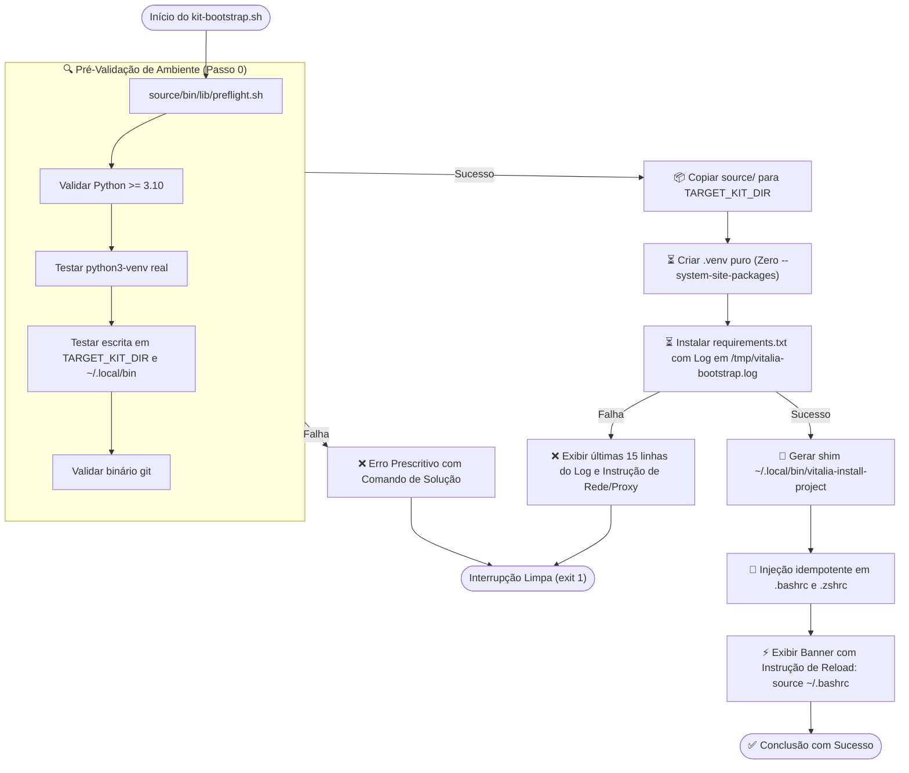

<!-- regencia-architect-plano-turno.md | Vitalia SPEC Kit v0.0.1 | 10-11-2026 19:10(GMT-04:00) -->
> **regencia-architect-plano-turno.md | Vitalia SPEC Kit v0.0.1 | 10-11-2026 19:10(GMT-04:00)**

# Regência Arquitetural e Plano de Turno — Spec 004: Pre-Flight Check e Verbosidade no Processo de Instalação

- **Feature Ativa:** `specs/004-installer-preflight-and-verbosity`
- **Arquiteto Responsável:** Vitalia Architect (`/vitalia-architect`)
- **Documento Conceitual Âncora:** [`specs/004-installer-preflight-and-verbosity/research-brainstorming.md`](file:///home/andre/projetos/assistidos/vitalia-spec-kit/specs/004-installer-preflight-and-verbosity/research-brainstorming.md)
- **ADR Vinculado:** [`docs/adr/ADR-0003-installer-preflight-isolated-venv-observability.md`](file:///home/andre/projetos/assistidos/vitalia-spec-kit/docs/adr/ADR-0003-installer-preflight-isolated-venv-observability.md)

---

## 1. Auditoria de Conformidade Constitucional (P00–P17)

| Princípio | Descrição | Status de Conformidade na Spec 004 |
|---|---|---|
| **P00 (Purpose Arbiter)** | Bem-estar de quem usa e de quem constrói. | **Conforme:** Elimina a frustração de instalação silenciosa/travada e evita corrupção de ambientes por pacotes globais conflitantes. |
| **P01 (SDD Pipeline Inviolability)** | Ciclo estrito de especificação formal. | **Conforme:** Nenhuma linha de código será modificada sem spec, plano técnico e tasks formalmente aprovadas. |
| **P02 (User-Centric Validation)** | Declaração de impacto ao desenvolvedor/usuário final. | **Conforme:** Feedback visual passo a passo (`⏳`, `✅`, `❌`, `⚠️`) e instruções claras para ativação imediata no shell. |
| **P03 (External Grounding)** | Verificação e rastreabilidade técnica. | **Conforme:** Links canônicos da documentação oficial de Python `venv`, Bash e FreeDesktop XDG validados na concepção. |
| **P04 (Timestamp GMT-04:00)** | Integridade temporal incondicional. | **Conforme:** Cabeçalhos duplo-stamp (comentário HTML + blockquote visível) em todos os artefatos Markdown. |
| **P05 (TDD & Falsification Matrix)** | Matriz de 4 Modalidades sem testes sintáticos rasos. | **Conforme:** Proibição de `assert path.is_file()` isolado; execução de cenários reais em `tmp_path` simulando PATH sem venv e diretórios somente-leitura. |
| **P06 (Secrets Never in Git)** | Blindagem de segredos e credenciais. | **Conforme:** Pre-flight de URLs Git valida formatos sem expor chaves ou senhas em tela ou logs de erro. |
| **P10 (Didactics-First)** | Engenharia didática e mensagens prescritivas. | **Conforme:** Mensagens de erro com causas raiz acionáveis e comandos exatos de cópia e cola para remediação. |
| **P11 (Runtime Autonomy & Agnosticism)** | Isolamento de runtime e zero acoplamento. | **Conforme:** Purga total de `--system-site-packages`; `.venv` 100% autônomo com dependências puras. |
| **P15 (Observability & Structured Logging)** | Observabilidade sem poluição de contexto. | **Conforme:** Redirecionamento de logs volumosos do pip para `/tmp/vitalia-bootstrap.log` e extração automática apenas do erro destilado. |
| **P16 (Defensive Mermaid)** | Labels de Mermaid entre aspas duplas. | **Conforme:** Diagramas com 100% dos nós e arestas entre aspas duplas, prevenindo quebra de renderização. |

---

## 2. Topologia do Fluxo de Instalação e Observabilidade

---

## 3. Engenharia Reversa Funcional em 3 Camadas

| Componente | Intenção a Preservar (Camada 1) | Legado a Purgar (Camada 2) | Contrato do Consumidor (Camada 3) |
|---|---|---|---|
| **`kit-bootstrap.sh`** | Instalação global na máquina hospedeira. | Purgar `--system-site-packages`, supressão silenciosa `pip >/dev/null`, e `mkdir` cego sem pre-flight. | Carregar `preflight.sh`, emitir status passo a passo, criar log `/tmp/vitalia-bootstrap.log` e banner com `source ~/.bashrc`. |
| **`source/bin/lib/preflight.sh`** | Garantir que o ambiente é viável antes de iniciar. | Novo componente modular (evita duplicação de validações de bash). | Funções bash testadas com códigos semânticos: `check_python_version`, `check_venv_capability`, `check_writable_paths`. |
| **`source/bin/install-project`** | Ativação do kit no projeto hospedeiro. | Purgar tentativa cega de clonagem/conexão Git sem pré-validação amigável. | Validar escrita no diretório do projeto e acessibilidade Git antes de alterar `.vitalia/` ou `.env`. |

---

## 4. Classificação na Matriz de Testes P05

- **`[TEST:NEW]`:** Testes unitários para a suíte `preflight.sh`:
  - `test_preflight_python_version_rejection`: Falha se aprovar Python < 3.10.
  - `test_preflight_readonly_target_directory`: Falha se não detectar diretório sem permissão de escrita.
  - `test_preflight_missing_venv_prescriptive_error`: Falha se não instruir o comando exato de instalação de `python3-venv`.
- **`[TEST:BUGFIX]`:** Testes de regressão do `kit-bootstrap.sh`:
  - `test_bootstrap_rejects_system_site_packages_on_pip_failure`: Simula falha do pip; falha se o script recorrer a `--system-site-packages` em vez de abortar com log em `/tmp/vitalia-bootstrap.log`.
  - `test_bootstrap_aborts_early_on_unwritable_destination`: Falha se o script criar pastas parciais antes do pre-flight check.
- **`[TEST:REFACTOR]`:** Teste de compatibilidade end-to-end:
  - `test_kit_bootstrap_clean_machine_e2e`: Execução funcional integral com o novo módulo `preflight.sh` integrado.

---

## 5. Próximo Passo do Pipeline SDD

A regência arquitetural e o enquadramento constitucional da Spec 004 estão finalizados.  
O próximo passo formal é acionar o **`/vitalia-spec-specify`** para redigir o `specs/004-installer-preflight-and-verbosity/spec.md` com os requisitos formais (`FR-001` a `FR-004`) e cenários de aceitação em formato Gherkin (`Given/When/Then`).

