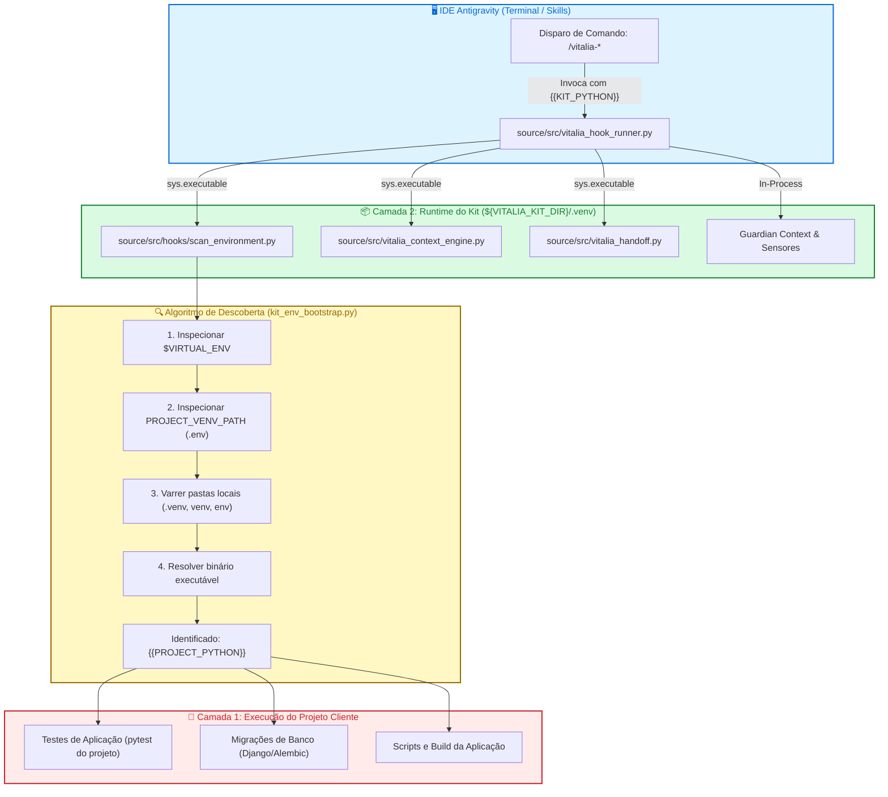

<!-- regencia-architect-plano-turno.md | Vitalia SPEC Kit v0.0.1 | 11-11-2026 06:40(GMT-04:00) -->
> **regencia-architect-plano-turno.md | Vitalia SPEC Kit v0.0.1 | 11-11-2026 06:40(GMT-04:00)**

# Regência Arquitetural e Plano de Turno — Spec 005: Resolução de Discrepância de Runtime e Arquitetura Dual-Virtualenv

- **Feature Ativa:** `specs/005-runtime-discrepancy-and-dual-venv`
- **Arquiteto Responsável:** Vitalia Architect (`/vitalia-architect`)
- **Documento Conceitual Âncora:** [`specs/005-runtime-discrepancy-and-dual-venv/research-brainstorming.md`](file:///home/andre/projetos/assistidos/vitalia-spec-kit/specs/005-runtime-discrepancy-and-dual-venv/research-brainstorming.md)
- **ADR Vinculado:** [`docs/adr/ADR-0004-dual-runtime-architecture-and-runner-inviolability.md`](file:///home/andre/projetos/assistidos/vitalia-spec-kit/docs/adr/ADR-0004-dual-runtime-architecture-and-runner-inviolability.md)

---

## 1. Auditoria de Conformidade Constitucional (P00–P17)

| Princípio | Descrição | Status de Conformidade na Spec 005 |
| :--- | :--- | :--- |
| **P00 (Purpose Arbiter)** | Bem-estar de quem usa e de quem constrói. | **Conforme:** Elimina a frustração de erros intermitentes de inicialização e tentativas redundantes de reinstalar o kit global. |
| **P01 (SDD Pipeline Inviolability)** | Ciclo estrito de especificação formal. | **Conforme:** A transição segue rigorosamente: Brainstorming $\to$ Route $\to$ Architect $\to$ Specify $\to$ Clarify $\to$ Plan $\to$ Tasks $\to$ Implement $\to$ Converge. |
| **P02 (User-Centric Validation)** | Declaração de impacto ao desenvolvedor. | **Conforme:** O desenvolvedor ganha previsibilidade na inicialização da sessão e suporte nativo a projetos com Poetry/Pipenv/Conda sem conflito de bibliotecas. |
| **P03 (External Grounding)** | Verificação e rastreabilidade técnica. | **Conforme:** Grounding formal sobre PEP 405, documentação da biblioteca `sys`/`subprocess` do Python 3 e modelo de sandbox da Antigravity IDE. |
| **P04 (Timestamp GMT-04:00)** | Integridade temporal incondicional. | **Conforme:** Cabeçalhos duplo-stamp (comentário HTML + blockquote visível) em 100% dos artefatos Markdown criados e editados. |
| **P05 (TDD & Falsification Matrix)** | Matriz de 4 Modalidades sem testes sintáticos rasos. | **Conforme:** Validação black-box por subprocesso com mock de `python3` quebrado no `$PATH` (`[TEST:BUGFIX]`), validação de discovery em 4 níveis (`[TEST:NEW]`) e linter contra regressões (`[TEST:REFACTOR]`). |
| **P06 (Secrets Never in Git)** | Blindagem de segredos e credenciais. | **Conforme:** Sem impacto direto; preserva a proteção de `.env`. |
| **P10 (Didactics-First)** | Engenharia didática e mensagens prescritivas. | **Conforme:** Avisos claros em `scan_environment` orientando o usuário caso o projeto local ainda não possua um ambiente virtual próprio configurado. |
| **P11 (Runtime Autonomy & Agnosticism)** | Isolamento de runtime e zero acoplamento. | **Conforme:** O pilar central da Spec 005. O Kit possui seu próprio `.venv` soberano na Camada 2 e não conflita com a Camada 1. |
| **P15 (Observability & Structured Logging)** | Observabilidade sem poluição de contexto. | **Conforme:** Diagnóstico de ambiente estruturado em JSON com nós explícitos `kit_runtime` e `project_runtime`. |
| **P16 (Defensive Mermaid)** | Labels de Mermaid entre aspas duplas. | **Conforme:** 100% dos diagramas Mermaid com nós e arestas entre aspas duplas. |

---

## 2. Diagrama de Topologia Dual-Runtime e Resolução de Comandos

---

## 3. Roteiro de Fases do Ciclo SDD (Spec 005)

1. **Fase 1: Especificação Formal (`/vitalia-spec-specify`)**
   - Criação de `specs/005-runtime-discrepancy-and-dual-venv/spec.md` com FR-001 a FR-005, critérios de aceitação e cenários BDD (Given/When/Then).
2. **Fase 2: Clarificação Adversarial (`/vitalia-clarify`)**
   - Varredura de ambiguidades contra a taxonomia de 10 categorias e validação de contratos.
3. **Fase 3: Planejamento Técnico e Arquitetura (`/vitalia-spec-plan`)**
   - Criação de `specs/005-runtime-discrepancy-and-dual-venv/plan.md` com matriz de migração, dependências e blueprint.
4. **Fase 4: Decomposição Atômica de Tarefas (`/vitalia-spec-tasks`)**
   - Criação de `tasks.md` com marcação P05 (`[TEST:NEW]`, `[TEST:BUGFIX]`, `[TEST:REFACTOR]`, `[TEST:MIGRATION]`) e cenários de falsificação.
5. **Fase 5: Auditoria Constitucional Pré-Implementação (`/vitalia-task-verifier` & `/vitalia-judge`)**
   - Veredito formal antes de qualquer escrita de código.
6. **Fase 6: Implementação TDD e Convergência (`/vitalia-spec-implement` & `/vitalia-converge`)**
   - Execução das tarefas Red $\to$ Green $\to$ Refactor e reconciliação.
7. **Fase 7: Auditoria Final e Encerramento (`/vitalia-analyze` & `/vitalia-session-end`)**
   - Inspeção de Git diff e commit atômico da Spec 005.

---

## 4. Próxima Ação Imediata
O plano está aprovado e formalizado. O despacho oficial conduzirá para a abertura da especificação formal da Spec 005 via:
`/vitalia-spec-specify`

