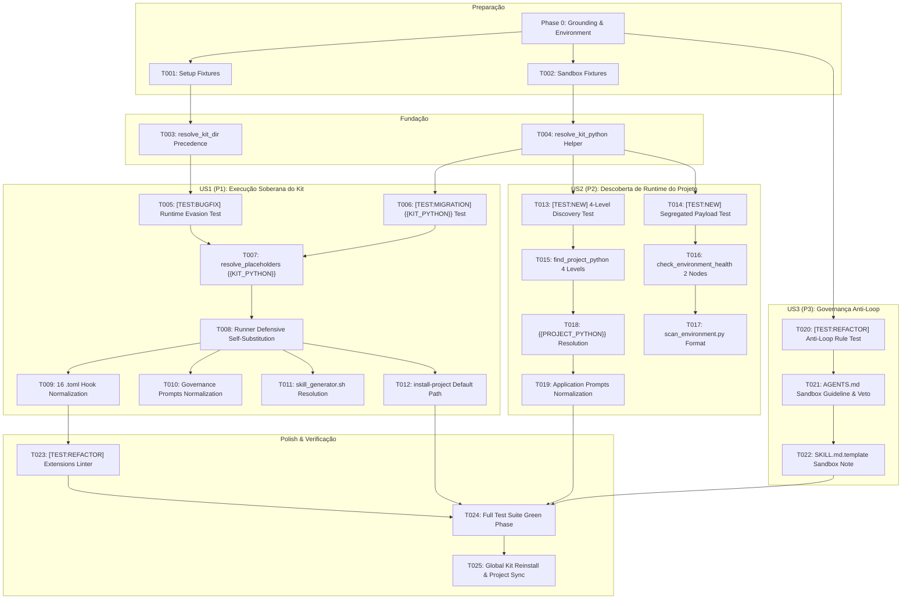

<!-- constitutional-status: APPROVED | auditor: red-team-vitalia | timestamp: 2026-11-11T10:05:55-04:00 | report: Relatório de inspeção.md -->
<!-- tasks.md | Vitalia SPEC Kit v0.0.1 | 11-11-2026 10:03(GMT-04:00) -->
> **tasks.md | Vitalia SPEC Kit v0.0.1 | 11-11-2026 10:03(GMT-04:00)**

# Tasks: Spec 005 — Runtime Discrepancy, Dual-Virtualenv and Runner Inviolability

**Spec**: [`specs/005-runtime-discrepancy-and-dual-venv/spec.md`](file:///home/andre/projetos/assistidos/vitalia-spec-kit/specs/005-runtime-discrepancy-and-dual-venv/spec.md) | **Plan**: [`specs/005-runtime-discrepancy-and-dual-venv/plan.md`](file:///home/andre/projetos/assistidos/vitalia-spec-kit/specs/005-runtime-discrepancy-and-dual-venv/plan.md)  
**Gerado em**: 11-11-2026 10:03(GMT-04:00)

---

## MVP Scope

> Implementar **Phase 1 (Setup) + Phase 2 (Foundational) + Phase 3 (US1: Execução Soberana do Kit via `{{KIT_PYTHON}}` e Auto-Substituição Defensiva no Runner)** entrega o kit 100% autônomo, imune a erros de ambiente do host e operacional em qualquer workspace.  
> As Phases 4 (US2: Descoberta de Runtime do Projeto), 5 (US3: Diretriz de Sandbox Anti-Loop) e 6 (Polish) completam a governança dual e a robustez cognitiva dos agentes.

---

## Phase 0: Grounding & Environment

*Verificações de integridade de ambiente antes de qualquer alteração de código. Sem label de US.*

- [X] T000-A Ativar e verificar interpretador do kit: executar `/home/andre/.vitalia-spec-kit/.venv/bin/python3 -c "import yaml, jinja2, jsonschema; print('KIT_VENV_OK')"`
- [X] T000-B Verificar versão do interpretador Python isolado: `/home/andre/.vitalia-spec-kit/.venv/bin/python3 --version`
- [X] T000-C Validar integridade dos pacotes do kit contra `requirements.txt`: `/home/andre/.vitalia-spec-kit/.venv/bin/python3 -m pip check`
- [X] T000-D Verificar ausência de alterações desavisadas na árvore git: `git status --porcelain`
- [X] T000-E Verificar integridade dos schemas OpenAPI 3.0 em `source/src/schemas/`

---

## Phase 1: Setup

*Preparação do ambiente de testes e fixtures de falsificação comportamental. Sem label de US.*

- [X] T001 [P] Criar suíte de testes de integração e regressão comportamental em [`tests/test_runtime_dual_venv.py`](file:///home/andre/projetos/assistidos/vitalia-spec-kit/tests/test_runtime_dual_venv.py) contendo fixtures para criação de ambientes virtuais isolados (`tmp_path`), projeto mock com `.env` customizado e mock de `python3` com falha.
- [X] T002 [P] Criar fixture de simulação de sandbox da IDE Antigravity em [`tests/conftest.py`](file:///home/andre/projetos/assistidos/vitalia-spec-kit/tests/conftest.py) para validação do comportamento de subprocessos sob isolamento de diretório.

---

## Phase 2: Foundational

*Fundação de resolução de runtimes e separação Camada 1 vs Camada 2. Sem label de US.*

- [X] T003 Refatorar `resolve_kit_dir` em [`source/src/kit_env_bootstrap.py`](file:///home/andre/projetos/assistidos/vitalia-spec-kit/source/src/kit_env_bootstrap.py) para garantir precedência estrita: `$VITALIA_KIT_DIR` $\to$ `.env` $\to$ `~/.vitalia-spec-kit`, removendo resolução estática para `source/`.
- [X] T004 Implementar função auxiliar `resolve_kit_python(kit_dir: Path) -> Path` em [`source/src/kit_env_bootstrap.py`](file:///home/andre/projetos/assistidos/vitalia-spec-kit/source/src/kit_env_bootstrap.py) resolvendo deterministicamente o interpretador de `${VITALIA_KIT_DIR}/.venv`.

---

## Phase 3: User Story 1 — Execução Soberana do Kit via `{{KIT_PYTHON}}` e Auto-Substituição Defensiva no Runner (P1)

**Story Goal**: Garantir que 100% das ferramentas e hooks de governança do kit executem incondicionalmente no interpretador `${VITALIA_KIT_DIR}/.venv/bin/python3`, mesmo se o terminal invocar `python3` ou se o host tiver ambiente Python quebrado ou sem pacotes.  
**Independent Test**: Injetar mock de `python3` quebrado no `$PATH` retornando erro 127 e executar hook `before` de workflow. O teste deve passar com sucesso utilizando `sys.executable`.  
**Referência**: FR-001.1, FR-001.4, FR-002.1, FR-002.2, FR-002.3, FR-003.1, FR-003.2, FR-004.1, FR-004.2, SC-001, SC-004

- [X] T005 [P] [US1] [TEST:BUGFIX] Escrever teste de reprodução de defeito para evasão de runtime em [`tests/test_runtime_dual_venv.py`](file:///home/andre/projetos/assistidos/vitalia-spec-kit/tests/test_runtime_dual_venv.py) — Cenário de Falsificação: injetar binário mock de `python3` no `$PATH` temporário retornando código 127 e falha imediata; o teste falha contra a implementação atual (Red Phase) porque `vitalia_hook_runner.py` invoca o `python3` do `$PATH`, e passa (Green Phase) somente quando o runner utilizar `sys.executable`.
- [X] T006 [P] [US1] [TEST:MIGRATION] Escrever teste de substituição de placeholder `{{KIT_PYTHON}}` em [`tests/test_runtime_dual_venv.py`](file:///home/andre/projetos/assistidos/vitalia-spec-kit/tests/test_runtime_dual_venv.py) — Cenário de Falsificação: executar `vitalia_hook_runner.py` com comando contendo `{{KIT_PYTHON}}`; o teste falha se a string literal permanecer não substituída no comando disparado pelo subprocesso.
- [X] T007 [US1] Implementar resolução do placeholder `{{KIT_PYTHON}}` e injeção da variável `VITALIA_KIT_PYTHON` na função `resolve_placeholders` em [`source/src/vitalia_hook_runner.py`](file:///home/andre/projetos/assistidos/vitalia-spec-kit/source/src/vitalia_hook_runner.py).
- [X] T008 [US1] Implementar auto-substituição defensiva de runtime em [`source/src/vitalia_hook_runner.py`](file:///home/andre/projetos/assistidos/vitalia-spec-kit/source/src/vitalia_hook_runner.py): inspecionar se o alvo `.py` do comando reside em `${VITALIA_KIT_DIR}` e reescrever chamadas `python3` para `sys.executable`.
- [X] T009 [P] [US1] Atualizar os 16 arquivos em [`source/extensions/*.toml`](file:///home/andre/projetos/assistidos/vitalia-spec-kit/source/extensions/) substituindo `python3 {{VITALIA_KIT_DIR}}` por `{{KIT_PYTHON}} {{VITALIA_KIT_DIR}}` nos hooks `before`.
- [X] T010 [P] [US1] Atualizar prompts operacionais nos arquivos [`source/extensions/session-start.toml`](file:///home/andre/projetos/assistidos/vitalia-spec-kit/source/extensions/session-start.toml), [`source/extensions/session-end.toml`](file:///home/andre/projetos/assistidos/vitalia-spec-kit/source/extensions/session-end.toml), [`source/extensions/session-consolidate.toml`](file:///home/andre/projetos/assistidos/vitalia-spec-kit/source/extensions/session-consolidate.toml), [`source/extensions/brainstorming.toml`](file:///home/andre/projetos/assistidos/vitalia-spec-kit/source/extensions/brainstorming.toml) e [`source/extensions/route.toml`](file:///home/andre/projetos/assistidos/vitalia-spec-kit/source/extensions/route.toml), instruindo o uso de `{{KIT_PYTHON}}` para utilitários internos do kit.
- [X] T011 [US1] Atualizar [`source/bin/lib/skill_generator.sh`](file:///home/andre/projetos/assistidos/vitalia-spec-kit/source/bin/lib/skill_generator.sh) para substituir o placeholder `{{KIT_PYTHON}}` pelo caminho físico do interpretador durante a geração de skills.
- [X] T012 [US1] Atualizar [`source/bin/install-project`](file:///home/andre/projetos/assistidos/vitalia-spec-kit/source/bin/install-project) ajustando `DEFAULT_KIT_DIR` para `${HOME}/.vitalia-spec-kit` como padrão caso invocado a partir do repositório clone sem a variável exportada.

---

## Phase 4: User Story 2 — Descoberta Dinâmica de Runtime do Projeto (`{{PROJECT_PYTHON}}`) e Observabilidade Segregada (P2)

**Story Goal**: Permitir que o kit descubra deterministicamente o ambiente virtual da aplicação hospedeira (suportando `$VIRTUAL_ENV`, `.env`, Poetry, Pipenv e fallback dinâmico) e forneça aos comandos de aplicação (`spec-implement`, `spec-tasks`) o executável correto sem poluir o kit.  
**Independent Test**: Configurar projeto mock com `.env` contendo `PROJECT_VENV_PATH=./custom_app_venv` e verificar se `scan_environment.py` emite payload segregado com `project_runtime.python_bin` apontando para o interpretador customizado ancorado na raiz do projeto.  
**Referência**: FR-001.2, FR-001.3, FR-002.1, FR-003.3, SC-002

- [X] T013 [P] [US2] [TEST:NEW] Escrever testes funcionais para descoberta em 4 níveis de ambiente virtual em [`tests/test_runtime_dual_venv.py`](file:///home/andre/projetos/assistidos/vitalia-spec-kit/tests/test_runtime_dual_venv.py) — Cenário de Falsificação: criar diretório de projeto mock com caminho relativo em `PROJECT_VENV_PATH`; o teste falha se `find_project_python` retornar `None` ou resolver caminho incorreto não ancorado em `project_root`.
- [X] T014 [P] [US2] [TEST:NEW] Escrever teste para payload segregado OpenAPI 3.0 em [`tests/test_runtime_dual_venv.py`](file:///home/andre/projetos/assistidos/vitalia-spec-kit/tests/test_runtime_dual_venv.py) — Cenário de Falsificação: executar `check_environment_health()` em projeto sem virtualenv; o teste falha se a chave `venv_ok` for mesclada ou se `project_runtime.has_venv` for `true`.
- [X] T015 [US2] Implementar algoritmo de descoberta em 4 níveis `find_project_python(project_root: Path)` com ancoragem relativa em [`source/src/kit_env_bootstrap.py`](file:///home/andre/projetos/assistidos/vitalia-spec-kit/source/src/kit_env_bootstrap.py).
- [X] T016 [US2] Refatorar `check_environment_health` em [`source/src/kit_env_bootstrap.py`](file:///home/andre/projetos/assistidos/vitalia-spec-kit/source/src/kit_env_bootstrap.py) para emitir payload estruturado segregado contendo nós `kit_runtime` e `project_runtime`.
- [X] T017 [US2] Atualizar [`source/src/hooks/scan_environment.py`](file:///home/andre/projetos/assistidos/vitalia-spec-kit/source/src/hooks/scan_environment.py) para formatar e emitir o payload segregado conforme o contrato [`specs/005-runtime-discrepancy-and-dual-venv/contracts/cli-contracts.md`](file:///home/andre/projetos/assistidos/vitalia-spec-kit/specs/005-runtime-discrepancy-and-dual-venv/contracts/cli-contracts.md).
- [X] T018 [US2] Implementar placeholder `{{PROJECT_PYTHON}}` com fallback dinâmico para `{{KIT_PYTHON}}` e injeção da variável `VITALIA_PROJECT_PYTHON` em [`source/src/vitalia_hook_runner.py`](file:///home/andre/projetos/assistidos/vitalia-spec-kit/source/src/vitalia_hook_runner.py).
- [X] T019 [P] [US2] Atualizar prompts operacionais nos arquivos [`source/extensions/spec-implement.toml`](file:///home/andre/projetos/assistidos/vitalia-spec-kit/source/extensions/spec-implement.toml) e [`source/extensions/spec-tasks.toml`](file:///home/andre/projetos/assistidos/vitalia-spec-kit/source/extensions/spec-tasks.toml) orientando a execução de suítes de testes de aplicação do cliente através de `{{PROJECT_PYTHON}}`.

---

## Phase 5: User Story 3 — Governança Constitucional Anti-Loop e Diretriz de Sandbox na IDE (P3)

**Story Goal**: Neutralizar a alucinação de agentes de IA diante de erro 127 de sandbox na IDE Antigravity, instruindo a reexecução com `BypassSandbox: true` e vetando terminantemente a execução reflexa de `kit-bootstrap.sh`.  
**Independent Test**: Verificar conformidade textual e ausência de ambiguidade nas regras de governança de `AGENTS.md` e `SKILL.md.template`.  
**Referência**: FR-005.1, FR-005.2, FR-005.3, SC-005

- [X] T020 [P] [US3] [TEST:REFACTOR] Escrever teste de integridade constitucional para regras anti-loop em [`tests/test_runtime_dual_venv.py`](file:///home/andre/projetos/assistidos/vitalia-spec-kit/tests/test_runtime_dual_venv.py) — Cenário de Falsificação: escanear `source/AGENTS.md` e `.agents/AGENTS.md`; o teste falha se a menção a erro 127, `BypassSandbox: true` ou o veto explícito a `kit-bootstrap.sh` estiverem ausentes.
- [X] T021 [US3] Atualizar a Seção 8 de [`source/AGENTS.md`](file:///home/andre/projetos/assistidos/vitalia-spec-kit/source/AGENTS.md) e [`/home/andre/projetos/assistidos/vitalia-spec-kit/.agents/AGENTS.md`](file:///home/andre/projetos/assistidos/vitalia-spec-kit/.agents/AGENTS.md) adicionando a diretriz mandatória de tratamento de erro 127 via `BypassSandbox: true` e o veto inviolável à auto-reinstalação reflexa via `./kit-bootstrap.sh`.
- [X] T022 [US3] Atualizar o item 1 de [`source/integrations/antigravity/SKILL.md.template`](file:///home/andre/projetos/assistidos/vitalia-spec-kit/source/integrations/antigravity/SKILL.md.template) incorporando a instrução de sandbox para os agentes da IDE.

---

## Phase 6: Polish & Cross-Cutting

*Verificação da suíte completa de testes, linter estático e sincronização de artefatos.*

- [X] T023 [P] [TEST:REFACTOR] Criar linter estático de integridade em [`tests/test_runtime_dual_venv.py`](file:///home/andre/projetos/assistidos/vitalia-spec-kit/tests/test_runtime_dual_venv.py) — Cenário de Falsificação: escanear os 16 arquivos em `source/extensions/*.toml`; o teste falha se qualquer arquivo contiver a string desprotegida `python3 {{VITALIA_KIT_DIR}}` nos blocos de hooks.
- [X] T024 Executar suíte completa de testes comportamentais P05 em Green Phase: `/home/andre/.vitalia-spec-kit/.venv/bin/python3 -m pytest tests/test_runtime_dual_venv.py -v`.
- [X] T025 Reinstalar o kit no diretório global via `kit-bootstrap.sh` (com bypass de sandbox) e executar `install-project` no repositório para regenerar `.agents/skills/` e `.agents/AGENTS.md`, comprovando que as skills e o ambiente permanecem 100% puros e operacionais.

---

## Dependency Graph

---

## Parallel Execution

As tarefas marcadas com **`[P]`** podem ser executadas simultaneamente por não possuírem dependências cruzadas pendentes:
- **Phase 1:** `T001` e `T002` operam em arquivos de teste separados.
- **Phase 3 (US1):** `T005` e `T006` podem ser elaborados em paralelo. Após `T008`, `T009` e `T010` operam em arquivos `.toml` distintos.
- **Phase 4 (US2):** `T013` e `T014` exercitam diferentes métodos de teste em paralelo. `T019` opera de forma independente em prompts.
- **Phase 5 (US3):** `T020` pode ser escrito em paralelo com testes das fases anteriores.
- **Phase 6 (Polish):** `T023` pode ser executado em paralelo com a revisão de documentação.

