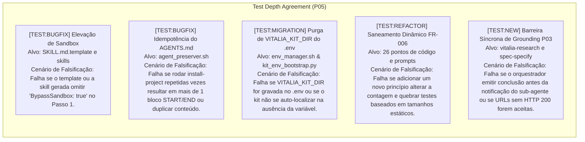

<!-- plan.md | Vitalia SPEC Kit v0.0.1 | 11-11-2026 21:50(GMT-04:00) -->
> **plan.md | Vitalia SPEC Kit v0.0.1 | 11-11-2026 21:50(GMT-04:00)**

# Implementation Plan: Spec 006 — Sandbox Elevation, Minimalist AGENTS.md, Variable Purge & Dynamic Constitution

- **Branch:** `main` (desenvolvimento assistido local)
- **Data:** 11-11-2026
- **Spec:** [`specs/006-sandbox-elevation-and-dynamic-constitution/spec.md`](file:///home/andre/projetos/assistidos/vitalia-spec-kit/specs/006-sandbox-elevation-and-dynamic-constitution/spec.md)
- **Research:** [`specs/006-sandbox-elevation-and-dynamic-constitution/research.md`](file:///home/andre/projetos/assistidos/vitalia-spec-kit/specs/006-sandbox-elevation-and-dynamic-constitution/research.md)
- **ADR Vinculado:** [`docs/adr/ADR-0005-proactive-sandbox-elevation-and-agnostic-governance.md`](file:///home/andre/projetos/assistidos/vitalia-spec-kit/docs/adr/ADR-0005-proactive-sandbox-elevation-and-agnostic-governance.md)

---

## 1. Summary

Esta feature resolve os atritos de usabilidade, rigidez de números mágicos e duplicidades identificados no Vitalia SPEC Kit:
1. Padroniza o Passo 1 do template de skill e de todas as skills instaladas para execução inicial com `BypassSandbox: true`, eliminando o erro de cold-start 127 (`No such file or directory`).
2. Reformula o `AGENTS.md` em um manifesto agnóstico de ~35 linhas, com foco no ecossistema multi-domínio e na Topologia Real de 3 Camadas no cliente instalado (`<project_root>/`, `<kit_dir>/` e `<project_root>/.vitalia/`).
3. Blinda o script `agent_preserver.sh` contra duplicações, garantindo idempotência estrita (FR-002.5).
4. Remove a injeção da variável `VITALIA_KIT_DIR` do `.env` do cliente em `source/bin/lib/env_manager.sh`, apoiando-se na auto-descoberta intrínseca de `kit_env_bootstrap.resolve_kit_dir()`.
5. Saneia exaustivamente os 26 pontos de números mágicos e contadores estáticos (FR-006).
6. Adota integralmente o Padrão Afirmativo canônico na Constituição e perfis, padronizando o Princípio P03 com barreira síncrona de Grounding HTTP 200.

---

## 2. Technical Context

- **Linguagem/Versão:** Python 3.10–3.14+ (isolado em `${VITALIA_KIT_DIR}/.venv`), Bash 4.4+ (POSIX-compliant)
- **Dependências Primárias:** `pyyaml`, `jinja2`, `jsonschema` (gerenciadas estritamente no `.venv` do kit)
- **Armazenamento:** Filesystem puro (envelopes JSON em `.vitalia/memory/data_storage/context/<machine_id>/`)
- **Testes:** `pytest` (executado via `${VITALIA_KIT_DIR}/.venv/bin/pytest`)
- **Plataforma Alvo:** Linux / POSIX / WSL2
- **Tipo de Projeto:** CLI Tool / Governança Agêntica SDD para IDE Antigravity
- **Metas de Desempenho:** Invocação de skills em 1 turno (zero colisões 127), tempo de execução de pre-flight < 1s, zero leaks de caminhos absolutos no `.env` do projeto cliente.
- **Restrições:** Zero containers locais (sem Redis/Postgres para o Kit), Zero Poda de contexto para modelos de fronteira, contratos OpenAPI 3.0 puros.

---

## 3. Constitution Check

- **P00 (PURPOSE):** Elimina o atrito do erro 127 no primeiro turno e o ruído cognitivo de arquivos duplicados ou âncoras negativas.
- **P01 (GOVERNANCE):** Pipeline SDD rigorosamente respeitado: specify ➔ plan ➔ tasks ➔ implement ➔ converge com auditoria do SDD-Judge.
- **P02 (GOVERNANCE):** Impacto ao desenvolvedor documentado e validado.
- **P03 (GROUNDING):** Rastro de fontes oficiais (Anthropic, OpenAI, Stanford, Linux Foundation) verificado via HTTP 200 em `research.md`.
- **P04 (INFRASTRUCTURE):** Cabeçalho duplo e fuso GMT-04:00 (America/Cuiaba) em 100% dos arquivos criados e modificados.
- **P05 (GOVERNANCE):** Estratégia de testes formalizada nas 4 modalidades ([TEST:NEW], [TEST:BUGFIX], [TEST:REFACTOR], [TEST:MIGRATION]) com Cenário de Falsificação explícito.
- **P06 (SECRETS):** Purga de caminhos absolutos locais do `.env` do cliente.
- **P11 (AGNOSTICISM):** Auto-localização intrínseca e contratos OpenAPI 3.0 limpos.
- **P16 (INFRASTRUCTURE):** Labels Mermaid entre aspas duplas, integridade física de arquivos e inserção cronológica reversa.

---

## 4. Technical Decisions

Consulte o arquivo [`specs/006-sandbox-elevation-and-dynamic-constitution/research.md`](file:///home/andre/projetos/assistidos/vitalia-spec-kit/specs/006-sandbox-elevation-and-dynamic-constitution/research.md) para o detalhamento completo de cada decisão, fontes auditadas (HTTP 200) e alternativas rejeitadas.

---

## 5. Matriz de Migração e Preservação Comportamental

| Componente | Comportamento Existente a Preservar (Invariante de Negócio) | Acoplamento / Defeito a Remover | Contrato do Consumidor & Estratégia de Teste (`[TEST:MIGRATION]`) |
| :--- | :--- | :--- | :--- |
| **`SKILL.md.template` & `.agents/skills/*/SKILL.md`** | Execução de hooks `before` e geração do envelope de contexto sem quebrar argumentos de entrada. | Erro de cold-start 127 decorrente da execução inicial desprovida da cláusula de elevação de sandbox. | Executar comando de skill no terminal da IDE e atestar que a execução inicial é disparada com `BypassSandbox: true` e conclui com código 0. |
| **`agent_preserver.sh`** | Preservação não-destrutiva de regras customizadas do usuário no `AGENTS.md`. | Duplicação de blocos por falha de simetria de marcadores ou repetição em execuções sucessivas de `install-project`. | Testar idempotência: executar `update_agents_md` múltiplas vezes sobre arquivo com ou sem duplicações prévias e atestar exatamente 1 bloco gerenciado e zero repetições. |
| **`env_manager.sh`** | Configuração do `.env` do projeto cliente preservando chaves de usuário existentes. | Injeção de caminhos absolutos locais (`VITALIA_KIT_DIR`) no `.env` do projeto hospedeiro. | Testar instalação em projeto limpo e atestar ausência de `VITALIA_KIT_DIR` no `.env`, comprovando auto-descoberta via `kit_env_bootstrap.resolve_kit_dir()`. |
| **`source/profiles/constitution.yaml` & `gp_*.yaml`** | Validação de 100% dos princípios constitucionais sem relaxamento de regras. | Formulações proibitivas negativas ("NUNCA", "PROIBIDO") e números mágicos estáticos (`P00–P17`, `P00 a P20`). | Testar que a constituição afirmativa carrega 100% dos princípios e que as lentes de fase aplicam os guardrails corretos. |
| **`source/extensions/*.toml`** | Execução de hooks `before` com Dual-Runtime (`{{KIT_PYTHON}}`). | Instruções de prompt contendo proibições negativas ou contagens estáticas de workflows/lentes. | Inspeção automatizada de conformidade estática assegurando zero ocorrências de contadores estáticos e redação afirmativa. |

---

## 6. Test Depth Agreement (TDA — Matriz Constitucional P05)

Em estrita conformidade com o Princípio P05, todo código e script a ser modificado possui modalidade e Cenário de Falsificação explícito, vetando testes sintáticos rasos:



---

## 7. Project Structure

### Documentação da Feature
```
specs/006-sandbox-elevation-and-dynamic-constitution/
├── research-brainstorming.md
├── regencia-architect-plano-turno.md
├── spec.md
├── checklists/
│   └── requirements.md
├── Relatório de Inspeção - specify.md
├── research.md
├── plan.md
├── Relatório de Inspeção - plan.md
└── tasks.md
```

### Código-Fonte Afetado (Repositório Raiz)
```
source/
├── AGENTS.md                                   (AGENTS.md minimalista agnóstico ~35 linhas)
├── bin/
│   ├── install-project                         (Instalador: chamada de sanitização de AGENTS.md)
│   └── lib/
│       ├── agent_preserver.sh                  (FR-002.5: Idempotência e deduplicação estrita)
│       ├── env_manager.sh                      (FR-003.1: Purga da injeção de VITALIA_KIT_DIR)
│       └── skill_generator.sh                  (FR-001.2: Passo 1 com BypassSandbox: true)
├── extensions/
│   └── *.toml                                  (Workflows com padrão afirmativo e contagem dinâmica)
├── integrations/
│   └── antigravity/
│       └── SKILL.md.template                   (FR-001.1: Passo 1 imperativo com BypassSandbox: true)
├── profiles/
│   ├── constitution.yaml                       (Padrão afirmativo integral e P03 padronizado)
│   └── gp_*.yaml                               (Lentes de fase afirmativas sem contadores estáticos)
└── src/
    ├── kit_env_bootstrap.py                    (FR-003.2: Auto-descoberta pura sem dependência de .env)
    └── hooks/
        └── scan_environment.py                 (Sanitização de números mágicos e mensagens dinâmicas)

.agents/
├── AGENTS.md                                   (Espelho unificado e deduplicado)
└── skills/
    └── vitalia-*/SKILL.md                      (Skills sincronizadas com Passo 1 elevado)

tests/
├── test_agent_preserver.py                     (Testes de idempotência e deduplicação)
├── test_env_bootstrap.py                       (Testes de auto-localização sem .env)
└── test_skills_pure.py                         (Testes de conformidade do Passo 1 com BypassSandbox: true)
```

---

## 8. Phase Overview (Fases de Implementação Atômica)

### Phase 1: Setup e Infraestrutura de Testes Red-First (P05)
- [T001]: Implementar teste `[TEST:BUGFIX]` em `tests/test_skills_pure.py` verificando a presença mandatória de `BypassSandbox: true` no Passo 1 do template e das skills geradas.
- [T002]: Implementar teste `[TEST:BUGFIX]` em `tests/test_agent_preserver.py` exercitando `update_agents_md` contra arquivos limpos, arquivos com marcadores duplicados e arquivos legados, assegurando idempotência e contagem exata de 1 único bloco.
- [T003]: Implementar teste `[TEST:MIGRATION]` em `tests/test_env_bootstrap.py` validando que a remoção de `VITALIA_KIT_DIR` do `.env` preserva a auto-descoberta de `kit_dir` e `project_root`.

### Phase 2: Elevação Proativa de Sandbox e Idempotência de Preservação
- [T004]: Atualizar `source/integrations/antigravity/SKILL.md.template` prescrevendo `BypassSandbox: true` mandatória e inicialmente no Passo 1.
- [T005]: Atualizar `source/bin/lib/skill_generator.sh` para injetar a prescrição de elevação no Passo 1 de todas as skills geradas.
- [T006]: Corrigir o algoritmo de substituição em `source/bin/lib/agent_preserver.sh` para garantir deduplicação estrita de blocos orfãos e idempotência total (FR-002.5).

### Phase 3: AGENTS.md Minimalista Agnóstico e Topologia de 3 Camadas
- [T007]: Redigir o novo `source/AGENTS.md` minimalista (~35 linhas), com Topologia de 3 Camadas Reais, agnóstico a domínios de código e sem âncoras negativas (`sdd_judge.py`, `kit-bootstrap.sh`).
- [T008]: Atualizar `source/bin/lib/env_manager.sh` expurgando a injeção da variável `VITALIA_KIT_DIR` no `.env` do cliente.
- [T009]: Sincronizar `.agents/AGENTS.md` com o novo manifesto minimalista e unificado.

### Phase 4: Saneamento Dinâmico de Números Mágicos (FR-006 em 26 Pontos)
- [T010]: Saneamento dos pontos de governança e perfis: `source/profiles/constitution.yaml`, `source/profiles/gp_*.yaml` e `source/profiles/agents_catalog.yaml`.
- [T011]: Saneamento dos 16 workflows em `source/extensions/*.toml`.
- [T012]: Saneamento dos scripts Python internos (`source/src/core/guardian_context.py`, `source/src/hooks/scan_environment.py`, renderizadores).
- [T013]: Saneamento das suítes de teste em `tests/` substituindo contagens estáticas por asserções dinâmicas.

### Phase 5: Adoção Integral do Padrão Afirmativo e Barreira Síncrona de Grounding
- [T014]: Reformular diretrizes proibitivas em `constitution.yaml` e `gp_*.yaml` para o padrão afirmativo ("say what to do instead of what not to do").
- [T015]: Padronizar o Princípio P03 com a fórmula oficial: *"Toda citação de versão, documentação, endpoint ou alegação científica exige confirmação de link ativo (HTTP 200) seguida de leitura integral da fonte."*
- [T016]: Atualizar os prompts de `research.toml` e `spec-specify.toml` formalizando a barreira síncrona obrigatória de orquestração.

### Phase 6: Dogfooding, Compilação de Skills e Validação Final
- [T017]: Executar regeneração de skills via `skill_generator.sh`, sincronizando todas as 16 skills em `.agents/skills/*/SKILL.md` com `BypassSandbox: true` inicial.
- [T018]: Executar a suíte de testes completa do kit (`tests/`) comprovando aprovação 100% verde sem regressões.
- [T019]: Submeter ao SDD-Judge (`/vitalia-judge --mode=converge`) e registrar handoff de encerramento.

