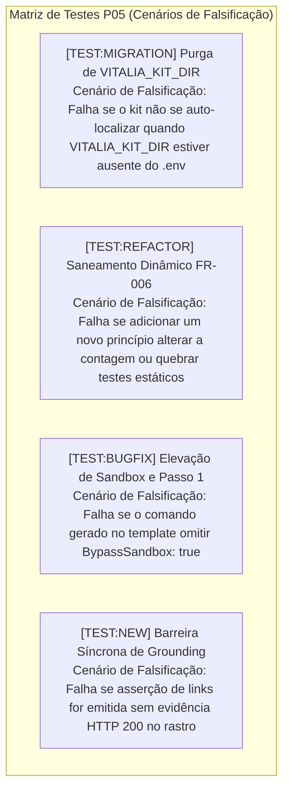

<!-- regencia-architect-plano-turno.md | Vitalia SPEC Kit v0.0.1 | 11-11-2026 21:30(GMT-04:00) -->
> **regencia-architect-plano-turno.md | Vitalia SPEC Kit v0.0.1 | 11-11-2026 21:30(GMT-04:00)**

# Regência Técnica do Vitalia Architect: Plano de Turno e Governança da Spec 006

- **Feature:** `specs/006-sandbox-elevation-and-dynamic-constitution`
- **Título:** Elevação Proativa de Sandbox, Governança Agnóstica e Minimalista de Agentes, Purga de Variáveis Redundantes, Padrão Afirmativo e Saneamento Dinâmico de Governança
- **Fase:** Transição Brainstorming ➔ Architect ➔ SDD Pipeline
- **Autor:** Vitalia Architect (`/vitalia-architect`)
- **ADR Vinculado:** [`docs/adr/ADR-0005-proactive-sandbox-elevation-and-agnostic-governance.md`](file:///home/andre/projetos/assistidos/vitalia-spec-kit/docs/adr/ADR-0005-proactive-sandbox-elevation-and-agnostic-governance.md)

---

## 1. Escopo Delimitado da Feature

```mermaid
flowchart LR
  subgraph InScope["In-Scope (Mandatório)"]
    IS1["Elevação Proativa de Sandbox (BypassSandbox: true inicial)"]
    IS2["AGENTS.md Minimalista Agnóstico (~35 linhas)"]
    IS3["Topologia Real de 3 Camadas do Kit Instalado"]
    IS4["Purga de VITALIA_KIT_DIR do .env do Cliente"]
    IS5["Saneamento Exaustivo de Números Mágicos (FR-006 em 26 pontos)"]
    IS6["Adoção Integral do Padrão Afirmativo na Constituição e Perfis"]
    IS7["Barreira Síncrona de Grounding P03"]
  end

  subgraph OutScope["Out-of-Scope (Preservação)"]
    OS1["Modificações na Lógica de Sensor Suite VRSS"]
    OS2["Alteração de Schemas de Shards de Sessão (vitalia_context_engine.py)"]
    OS3["Quebra de Assinaturas de API CLI de vitalia_handoff.py"]
  end

  InScope -.->|"Protegido contra Regressão"| OutScope
```



### 1.1. In-Scope (Entregáveis Estruturantes)
1. **Elevação Proativa de Sandbox:**
   - Atualização de `source/integrations/antigravity/SKILL.md.template` para prescrever `BypassSandbox: true` mandatória e inicialmente no Passo 1.
   - Atualização em lote de todas as skills em `.agents/skills/*/SKILL.md`.
2. **AGENTS.md Minimalista e Agnóstico:**
   - Redução para ~35 linhas com foco em propósito e ecossistema de especialistas.
   - Migração de regras específicas de código (TDD, P05) para a Constituição dinâmica.
   - Eliminação de referências a ferramentas inexistentes (`sdd_judge.py`) ou proibições estáticas de comandos (`kit-bootstrap.sh`).
   - Declaração da Topologia Real de 3 Camadas do cliente instalado.
3. **Purga da Variável `VITALIA_KIT_DIR` do `.env`:**
   - Remoção de injeção em `source/bin/lib/env_manager.sh`.
   - Confiança exclusiva na auto-descoberta de `kit_env_bootstrap.resolve_kit_dir()` e `resolve_project_root()`.
4. **Saneamento Dinâmico de Números Mágicos (FR-006):**
   - Eliminação de contadores fixos nos 26 pontos mapeados em código, testes e prompts, adotando resolução dinâmica por tamanho de dicionários/listas ou formulação semântica.
5. **Padrão Afirmativo Integral:**
   - Substituição de regras negativas em `constitution.yaml`, `gp_*.yaml` e `extensions/*.toml` por formulações afirmativas da forma desejada.
6. **Protocolo Estrito de Grounding (P03):**
   - Formulação oficial afirmativa: *"Toda citação de versão, documentação, endpoint ou alegação científica exige confirmação de link ativo (HTTP 200) seguida de leitura integral da fonte."*
   - Barreira de orquestração síncrona obrigando a IA orquestradora a aguardar a conclusão do sub-agente antes de prosseguir.

---

## 2. Engenharia Reversa em 3 Camadas

Para garantir transição segura sem amputação funcional, aplicamos a decomposição em 3 Camadas:

| Camada | Descrição no Estado Atual | Tratamento na Spec 006 |
| :--- | :--- | :--- |
| **1. Intenção de Negócio Pura** | Governança constitucional dinâmica, oráculo Guardian sem perda de contexto (§11), roteamento inteligente e execução blindada de workflows. | **Preservar 100%:** O ecossistema agêntico continua orquestrado pelo Guardian e despachado pelo catálogo de agentes. |
| **2. Infraestrutura a Purgar** | Dependência de `VITALIA_KIT_DIR` no `.env`, números mágicos estáticos (`P00–P17`, `16 workflows`, etc.), comandos 127 de sandbox e formulações proibitivas negativas. | **Purgar Integralmente:** Eliminação de variáveis redundantes, substituição por contagem dinâmica e conversão afirmativa. |
| **3. Contrato do Consumidor** | Invocação transparente via `/vitalia-*` na IDE Antigravity sem colisões e sem necessidade de auto-reparos manuais. | **Reforçar:** Passo 1 com elevação proativa (`BypassSandbox: true`) acionando a exceção do sistema Antigravity a priori. |

---

## 3. Estratégia de Testes na Matriz P05

Todas as tarefas de teste a serem criadas no pipeline SDD seguirão estritamente a **Matriz Bidimensional P05**:



- **Veto Absoluto a Testes Sintáticos Rasos:** Proibido validar conclusões apenas com `assert path.is_file()` ou `assert "string" in text`. Todos os testes devem validar execução comportamental via subprocessos ou inspeção semântica profunda.

---

## 4. Próxima Etapa no Pipeline SDD

Com as decisões arquiteturais fundamentadas no [`ADR-0005`](file:///home/andre/projetos/assistidos/vitalia-spec-kit/docs/adr/ADR-0005-proactive-sandbox-elevation-and-agnostic-governance.md), o próximo passo é avançar para a formalização da especificação funcional:

```
/vitalia-spec-specify
```

