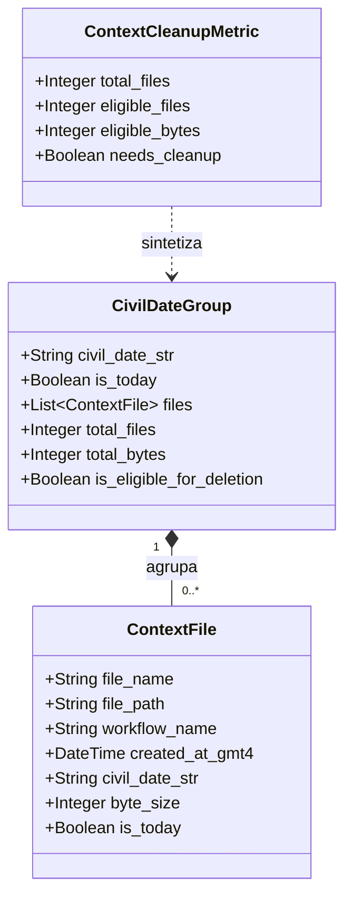

<!-- data-model.md | Vitalia SPEC Kit v0.0.1 | 15-11-2026 12:20(GMT-04:00) -->
> **data-model.md | Vitalia SPEC Kit v0.0.1 | 15-11-2026 12:20(GMT-04:00)**

# Data Model: [BUGFIX] Faxineiro de Contexto CLI & Saúde de Sessão (Spec 007)

## 1. Visão Geral de Entidades

O Faxineiro de Contexto e o Sensor de Ambiente operam sobre os arquivos efêmeros gerados pelos hooks de workflows SDD e as métricas de saúde emitidas pelo sensor de ambiente.



---

## 2. Entidade: ContextFile (Arquivo Físico de Contexto)

- **file_name**: String (ex: `clarify_20261115_121740_7b3f8212ca0d.json`).
- **file_path**: String (Caminho absoluto ou relativo em `.vitalia/memory/data_storage/context/<machine_id>/`).
- **workflow_name**: String (ex: `clarify`, `spec-plan`, `spec-tasks`).
- **created_at_gmt4**: DateTime com fuso horário `America/Cuiaba` (GMT-04:00 fixo).
- **civil_date_str**: String formatada `DD-MM-YYYY` (ex: `15-11-2026`).
- **byte_size**: Integer >= 0 (Tamanho em bytes no disco).
- **is_today**: Boolean (Verdadeiro se `civil_date_str == today_gmt4`).

---

## 3. Entidade: CivilDateGroup (Agrupamento por Dia Civil)

- **civil_date_str**: String `DD-MM-YYYY` (chave de agrupamento).
- **is_today**: Boolean.
- **files**: Lista de `ContextFile`.
- **total_files**: Integer >= 0.
- **total_bytes**: Integer >= 0.
- **is_eligible_for_deletion**: Boolean (True se `not is_today` ou se purga total for solicitada).

---

## 4. Entidade: ContextCleanupMetric (Nó OpenAPI 3.0 Limpo em scan_environment)

Contrato estrito validado por `contracts/context_cleanup.schema.json`:

```json
{
  "total_files": 42,
  "eligible_files": 38,
  "eligible_bytes": 1048576,
  "needs_cleanup": true
}
```

- **total_files**: Integer, mínimo 0. Contagem total de arquivos no diretório de contexto.
- **eligible_files**: Integer, mínimo 0. Contagem de arquivos com data civil anterior a hoje (GMT-04:00).
- **eligible_bytes**: Integer, mínimo 0. Total de bytes ocupados pelos `eligible_files`.
- **needs_cleanup**: Boolean. `True` se e somente se `eligible_files > 0`.
