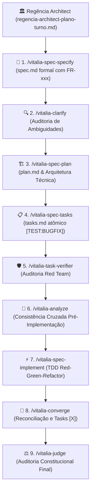

<!-- regencia-architect-plano-turno.md | Vitalia SPEC Kit v0.0.1 | 15-11-2026 11:30(GMT-04:00) -->
> **regencia-architect-plano-turno.md | Vitalia SPEC Kit v0.0.1 | 15-11-2026 11:30(GMT-04:00)**

# Regência Técnica do Vitalia Architect: Plano de Turno e Governança da Spec 007

- **Feature:** `specs/007-fix-context-cleanup-cli-and-session-health`
- **Título:** [BUGFIX] Correção do CLI Faxineiro, Menu Interativo de Contexto e Indicador de Saúde da Sessão
- **Natureza:** `[BUGFIX]` (Bug Reproduction First sob Matriz P05)
- **Fase:** Transição Brainstorming ➔ Route ➔ Architect ➔ SDD Pipeline
- **Autor:** Vitalia Architect (`/vitalia-architect`)
- **Fontes Canônicas:**
  - [`specs/007-fix-context-cleanup-cli-and-session-health/research-brainstorming.md`](file:///home/andre/projetos/assistidos/vitalia-spec-kit/specs/007-fix-context-cleanup-cli-and-session-health/research-brainstorming.md)
  - [`specs/003-modular-runtime-and-sensor-suite/relatorio_contratos_sdd_e_faxineiro.md`](file:///home/andre/projetos/assistidos/vitalia-spec-kit/specs/003-modular-runtime-and-sensor-suite/relatorio_contratos_sdd_e_faxineiro.md) (Seção 3)
  - [`docs/CONTRATOS_WORKFLOWS_SDD.md`](file:///home/andre/projetos/assistidos/vitalia-spec-kit/docs/CONTRATOS_WORKFLOWS_SDD.md)
  - [`docs/MEMORANDO DE ARQUITETURA.md`](file:///home/andre/projetos/assistidos/vitalia-spec-kit/docs/MEMORANDO%20DE%20ARQUITETURA.md)

---

## 1. Escopo Delimitado da Feature

```mermaid
flowchart LR
  subgraph InScope["In-Scope (Mandatório / BUGFIX)"]
    IS1["Motor de Agrupamento Temporal por Data (DD-MM-YYYY GMT-04:00)"]
    IS2["Preservação Obrigatória da Sessão Ativa ('📅 hoje')"]
    IS3["Menu Interativo Canônico '[a/d/n/t]' com Parser Granular"]
    IS4["Automação Headless e Flags CLI (--dry-run, --force, --purge-all)"]
    IS5["Inspeção Ultraleve de Saúde em scan_environment.py"]
    IS6["Indicador Informativo Discreto no /vitalia-session-start"]
    IS7["Exposição do Shim Executável source/bin/vitalia-clean"]
    IS8["Suíte de Testes [TEST:BUGFIX] (Bug Reproduction First)"]
  end

  subgraph OutScope["Out-of-Scope (Preservação / Blindagem)"]
    OS1["Reintrodução de Matrizes de Limpeza dentro de guardian_json (Veto ADR-0002)"]
    OS2["Mutações Destrutivas na Inspeção do scan_environment.py (Estritamente Read-Only)"]
    OS3["Alteração em Schemas de Shards ou Memória de Sessão (.vitalia/memory/session/)"]
  end

  InScope -.->|"Protegido contra Regressão"| OutScope
```



### 1.1. In-Scope (Entregáveis Estruturantes)
1. **Motor de Agrupamento Temporal por Data:**
   - Extrair a data de criação do padrão de nomenclatura `<workflow>_<YYYYMMDD>_<HHMMSS>_<hash>.json` com fallback defensivo para o `mtime` do arquivo.
   - Agrupar e contabilizar quantidade e tamanho em KB/MB para cada dia civil (`America/Cuiaba GMT-04:00`).
2. **Preservação Automática da Sessão Ativa (`📅 hoje`):**
   - Isolar os arquivos gerados na data corrente da máquina hospedeira.
   - Rotular a data de hoje como `📅 hoje (DD-MM-YYYY, sessão ativa — preservada automaticamente)` e excluí-la de qualquer purga padrão.
3. **Menu Interativo Canônico `[a/d/n/t]` e Parser Granular:**
   - `[a]`: Apagar tudo exceto hoje.
   - `[d]`: Solicitar datas específicas com parser de índices e faixas (ex: `1,2` ou `1-3`).
   - `[n]`: Não apagar nada (cancelamento padrão ao pressionar Enter).
   - `[t]`: Apagar tudo (inclusive hoje — purga total deliberada).
4. **Contrato de Automação Headless e Flags CLI:**
   - `--dry-run`: Exibe o agrupamento temporal e simula a remoção sem deletar nenhum arquivo físico.
   - `--force`: Modo não-interativo com comportamento correspondente à opção `[a]` (apaga dias anteriores e protege hoje).
   - `--purge-all`: Modo não-interativo com comportamento correspondente à opção `[t]` (purga completa deliberada).
   - `--target-dir`: Permite especificar a raiz do projeto alvo.
   - `--help`: Documentação didática em conformidade com o Princípio P10.
5. **Inspeção de Saúde Ultraleve (`scan_environment.py`):**
   - Adicionar rotina read-only que calcula rapidamente o volume e contagem de envelopes de dias anteriores em `.vitalia/memory/data_storage/context/<machine_id>/`.
   - Injetar no diagnóstico de ambiente (`env_summary.context_cleanup`) sem expandir listas de arquivos nem gerar ruído cognitivo.
6. **Aviso Amigável no `/vitalia-session-start`:**
   - Atualizar `source/extensions/session-start.toml` para exibir uma dica de manutenção não-bloqueante no chat quando houver acúmulo:
     `💡 Manutenção de Disco: Existem N envelopes de sessões anteriores (X KB) em .vitalia/memory/data_storage/context/. Execute 'vitalia-clean' no terminal para gerenciar.`
7. **Exposição do Wrapper Executável:**
   - Criar `source/bin/vitalia-clean` apontando para `{{KIT_PYTHON}} {{VITALIA_KIT_DIR}}/src/vitalia_tmp_cleanup.py`.
8. **Matriz de Testes `[TEST:BUGFIX]` (P05):**
   - Teste de reprodução do defeito atual: comprovar que o código antigo apaga indiscriminadamente sem proteger hoje e não possui menu `[a/d/n/t]`.
   - Testes unitários com simulação de `stdin` cobrindo todas as opções interativas e casos de borda.

### 1.2. Out-of-Scope (Preservação e Não-Regressão)
- **Veto à Reintrodução de Ruído:** É terminantemente proibido reinjetar listas de arquivos ou menus de faxina dentro do payload `guardian_json`. A IA não deve ser requisitada para escolher arquivos a limpar.
- **Inviolabilidade da Camada 3:** O faxineiro atua estritamente sobre envelopes transitórios em `.vitalia/memory/data_storage/context/`. Arquivos de sessão em `.vitalia/memory/session/` são intocáveis pela ferramenta de faxina.

---

## 2. Auditoria Constitucional Prévia (P00 a P17)

| Princípio | Descrição | Status de Conformidade na Regência |
| :--- | :--- | :---: |
| **P00 (Human Wellbeing)** | O utilitário elimina frustração de acúmulo de arquivos órfãos e previne a perda acidental de envelopes da sessão em andamento. | ✅ **CONFORME** |
| **P01 (SDD Inviolability)** | A correção é conduzida sob o pipeline formal completo (`specify` ➔ `clarify` ➔ `plan` ➔ `tasks` ➔ `implement` ➔ `converge` ➔ `judge`). | ✅ **CONFORME** |
| **P03 (Grounding)** | Ancoragem direta na especificação formal herdada da Spec 003 e nos padrões de biblioteca Python 3.10+. | ✅ **CONFORME** |
| **P04 (Timestamp)** | Cabeçalhos institucionais e exibição de datas padronizadas no fuso imutável `America/Cuiaba GMT-04:00`. | ✅ **CONFORME** |
| **P05 (TDD Inviolável)** | Enquadramento obrigatório em `[TEST:BUGFIX]` com prova de falha do código atual antes da correção. | ✅ **CONFORME** |
| **P10 (Didactic Engineering)** | Flag `--help` estruturada com descrição, opções e exemplos didáticos de uso. | ✅ **CONFORME** |
| **P11 (Dual-Runtime)** | O script do faxineiro opera sob o interpretador isolado do kit (`{{KIT_PYTHON}}`). | ✅ **CONFORME** |
| **P16 (Artifact Integrity)** | Diagramas Mermaid com labels entre aspas duplas e inserções cronológicas ordenadas. | ✅ **CONFORME** |

---

## 3. Matriz de Riscos e Mitigações Técnicas

| Risco Técnico | Probabilidade | Impacto | Estratégia de Mitigação |
| :--- | :---: | :---: | :--- |
| **Deleção acidental de envelopes de hoje** | Alta no código atual | Crítico | Isolamento algorítmico de arquivos cuja data coincida com a data local da máquina hospedeira. |
| **Travamento de CI por prompt interativo** | Média | Alto | Adoção estrita de flags não-interativas (`--force` e `--purge-all`) para pipelines automatizados. |
| **Divergência de fuso horário na extração da data** | Baixa | Moderado | Parsing da data baseado primordialmente na string do nome do arquivo (`_YYYYMMDD_`), independente de fuso do sistema operacional. |
| **Regressão atencional da LLM no session-start** | Média | Crítico | O diagnóstico do hook apenas reporta números planos no sumário; zero injeção de matrizes de arquivos no prompt cognitivo. |

---

## 4. Pipeline de Execução e Próximos Passos SDD



### Transição Imediata
O plano de turno encontra-se consolidado e pronto para execução. A próxima etapa mandatória do pipeline é a redação formal dos requisitos comportamentais:

```text
/vitalia-spec-specify
```
